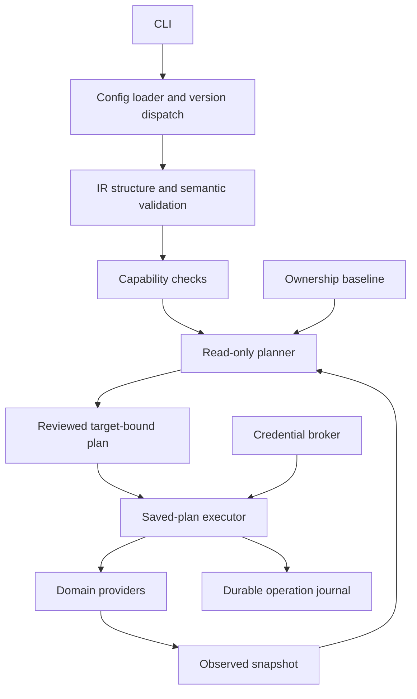

# Architecture

PowerCanvas is a deterministic CLI. AI, if added later, proposes the same validated IR used by humans. It does not receive execution authority.

```text
src/
  cli/          Commander entry point and result rendering
  config/       Bounded YAML parsing, schema-version dispatch, scaffold
  ir/           Strict versioned domain schema, semantic rules, identity
  core/         JSON hashing, typed errors, structured redacted logging
  providers/    Capability catalog and typed provider lifecycle contracts
  auth/         Tenant/audience-bound MSAL sessions and OS-protected cache
  dataverse/    Read-only discovery, normalization and curated payloads
  model-driven/ Bounded app/forms/views/navigation/role discovery and mutations
  planner/      Three-way semantic comparison and saved-plan validation
  execution/    Locked, journaled apply and explicit read-only recovery
  state/        Observation, ownership, plan, journal schemas and local store
templates/      Versioned complaint-management input used by init
examples/       Checked-in reference project, validated by the actual CLI
tests/          Unit and compiled-CLI tests; no simulated tenant claims
docs/           Design, decisions, experiments and factual status
experiments/    Dataverse, model-driven and separate Canvas protocols
```

One private npm package keeps installation, compilation and versioning simple. Modules use explicit imports; no service container, public plugin framework, database or cloud backend. Commander handles parsing, Zod supplies runtime structure/types and JSON Schema, YAML parses data, and Vitest tests behavior. Node 22.18+ is the initial minimum; CI covers Node 22 and 24 on Windows and Linux.



The CLI, authentication/discovery, Dataverse planner and saved-plan executor are implemented. The model-driven provider uses that same lifecycle behind an explicit experiment/evidence gate; managed ALM remains deferred. Live verification is tracked separately in the implementation status. Plans cannot be manufactured from desired input alone and represented as discovery results.

Cross-module rules: the IR never imports HTTP or credentials; providers never prompt; the CLI never builds Microsoft payloads; logging never serializes arbitrary provider errors; state accepts only its strict public schema. A provider cannot select a new tenant mid-operation. Observed descriptions are data, never executable instructions.
