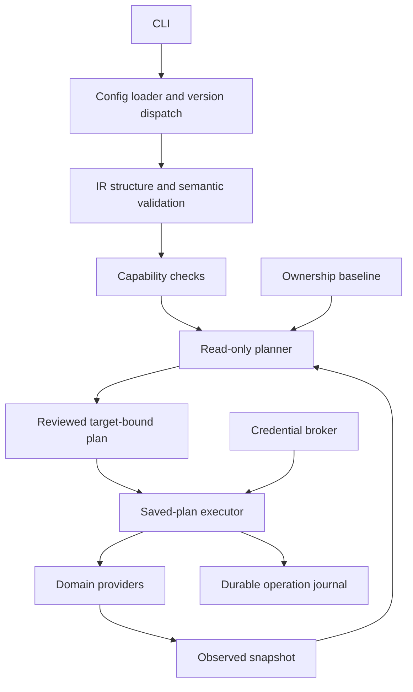

# Architecture

PowerCanvas is a deterministic CLI. AI, if added later, proposes the same validated IR used by humans. It does not receive execution authority.

```text
src/
  cli/          Commander entry point and result rendering
  config/       Bounded YAML parsing, schema-version dispatch, scaffold
  ir/           Strict versioned domain schema, semantic rules, identity
  core/         JSON hashing, typed errors, structured redacted logging
  providers/    Capability catalog and typed provider lifecycle contracts
  auth/         Tenant/audience-bound MSAL sessions and OS-protected cache
  dataverse/    Read-only discovery, normalization and curated payloads
  model-driven/ Bounded app/forms/views/navigation/role discovery and mutations
  planner/      Three-way semantic comparison and saved-plan validation
  execution/    Locked, journaled apply and explicit read-only recovery
  state/        Observation, ownership, plan, journal schemas and local store
templates/      Versioned complaint-management input used by init
examples/       Checked-in reference project, validated by the actual CLI
tests/          Unit and compiled-CLI tests; no simulated tenant claims
docs/           Design, decisions, experiments and factual status
experiments/    Dataverse, model-driven and separate Canvas protocols
```

One private npm package keeps installation, compilation and versioning simple. Modules use explicit imports; no service container, public plugin framework, database or cloud backend. Commander handles parsing, Zod supplies runtime structure/types and JSON Schema, YAML parses data, and Vitest tests behavior. Node 22.18+ is the initial minimum; CI covers Node 22 and 24 on Windows and Linux.



The CLI, authentication/discovery, Dataverse planner and saved-plan executor are implemented. The model-driven provider uses that same lifecycle behind an explicit experiment/evidence gate; managed ALM remains deferred. Live verification is tracked separately in the implementation status. Plans cannot be manufactured from desired input alone and represented as discovery results.

Cross-module rules: the IR never imports HTTP or credentials; providers never prompt; the CLI never builds Microsoft payloads; logging never serializes arbitrary provider errors; state accepts only its strict public schema. A provider cannot select a new tenant mid-operation. Observed descriptions are data, never executable instructions.

## Provider convergence, deployment convergence and production readiness

These are separate deterministic readiness dimensions in Solution IR and `solution audit`.

**Provider convergence** means every native root is an owned semantic NO_OP or an explicitly accepted lifecycle deferral, with no executable operations, blockers, conflicts or unresolved outcomes. The only V2 accepted deferral is supported model-driven app access waiting for publication under source policy `manual`, with a verified draft app and explicit publication/role dependency chain. Arbitrary blocked resources never count. Fresh discovery, ownership and retained ValidateApp results remain required. Canvas/Flow state is reported separately, not silently promoted by native provider success.

**Deployment convergence** additionally requires published apps, applied access associations, resolved deployment configuration and completed deployment-specific checks. It is not inferred from provider acceptance or capability maturity.

**Production readiness** additionally needs the relevant persona authorization, human/team assignments, licensing, runtime tests, managed import, cross-environment ALM and native Canvas authoring evidence. PowerCanvas does not currently certify it from native NO_OP.

Dataverse / Model-Driven / Security Provider V2 is complete for the bounded compiler/provider scope once its immutable evidence manifest passes the accepted draft boundary. Publication/access remains a separately authorized deployment track. Existing provider-regression assets are retained, never recreated to obtain more evidence. See [V2 provider closure](solution-v2-provider-closure.md).

The next major resource family is **SharePoint Solution Provider**: existing-site binding and first-class list/library, fields, content types, lookups, folders, views, permission boundaries, Canvas/Flow bindings and external-resource lifecycle. This is a recorded next phase, not implemented by V2 closure.
