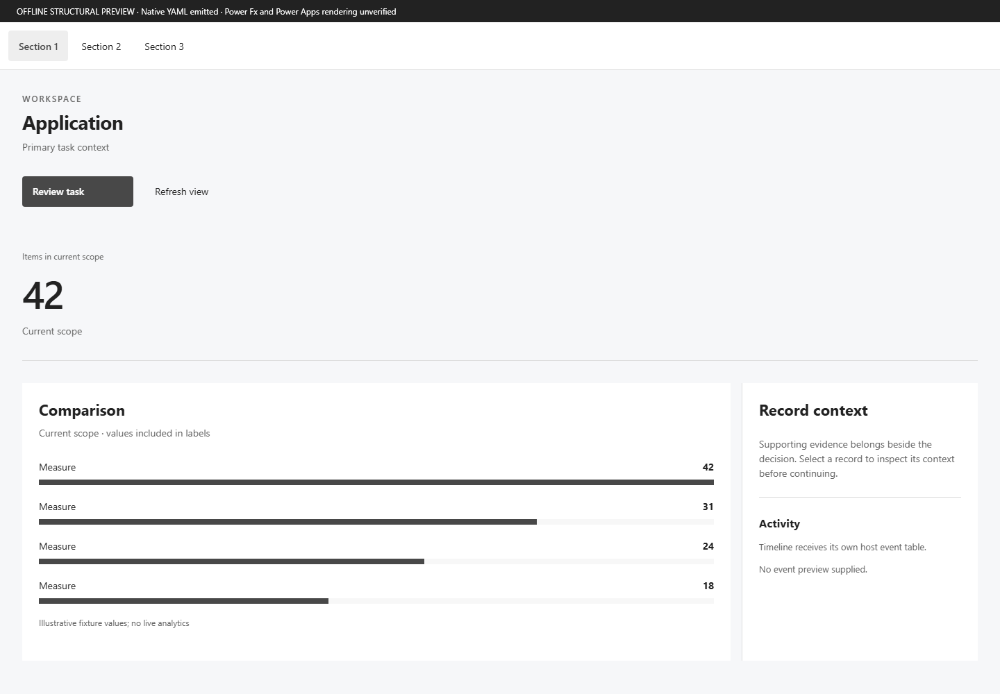
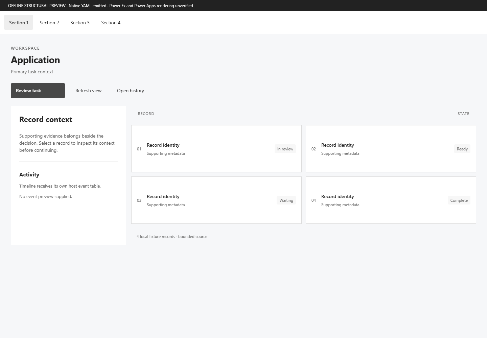
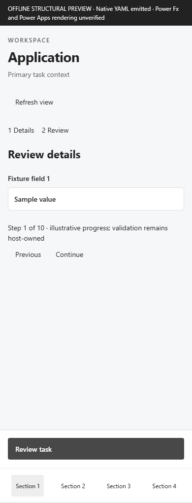
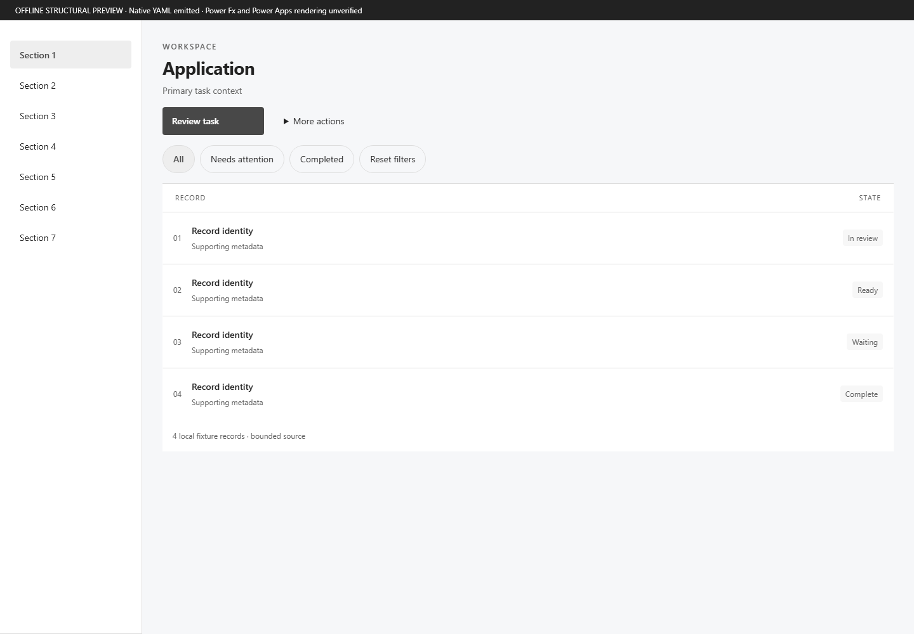
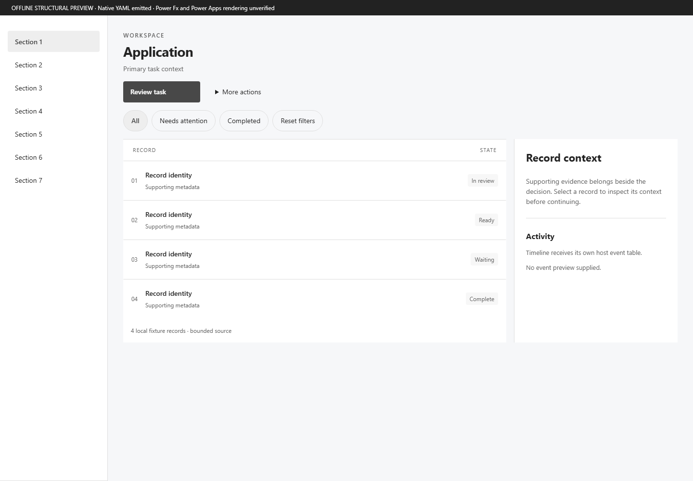
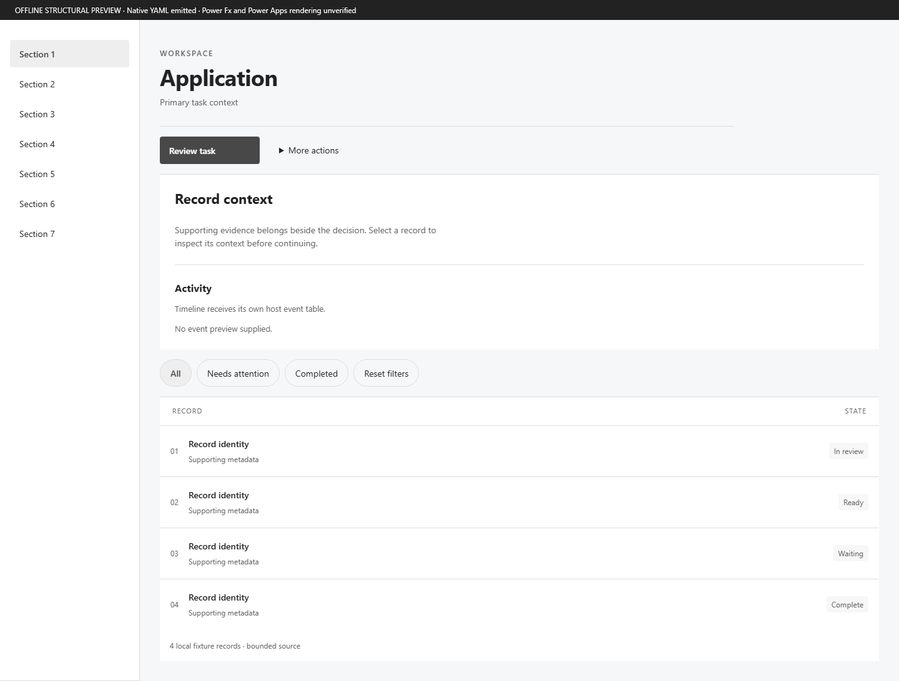

# Design Engine V4 — offline implementation report

The executable library and contextual composer are implemented locally. This report does **not** mark the full native/production quality gate complete. No Power Apps runtime was opened or tenant application created for this work.

## Current-state audit

The baseline at `a184c79` contained **22 native factories and 23 executable variants**, including the quiet StatusBadge branch. The recipe registry advertised **129 names**: 22 factories, 8 control mappings without factories, and 99 planned names. Aspirational variant arrays were not executable evidence. A separate older semantic IR has 19 components; those overlap and are not added to the native family count.

Existing factories: ActivityTimeline, ChartCard, CommandBar, ConfirmationDialog, DataTable, DetailPanel, EditDialog, EmptyState, ErrorState, FilterBar, FormSection, KpiCard, LoadingState, MobileBottomActions, MobileTaskForm, PageHeader, SearchBox, Sidebar, StatusBadge, Stepper, Tabs, UserAvatar.

Native generation previously chose a fixed sidebar/workspace structure before Taste refinement. Personality dials affected tokens and a small set of structural choices. Registry names could therefore suggest more expressive capability than factories delivered. The old refinement file also contained specific Complaint Desk identities and copy.

## Architecture and actual additions

The shared `pattern()` dispatch now has **41 executable native factories and 65 executable variants**. That is 19 new families and 42 new variants. No second control runtime, PCF package, React library or tenant application was introduced.

New families: TopNavigation, RichList, BulkActionBar, OverflowMenu, Skeleton, BottomNavigation, NavigationDrawer, CompactSidebar, SideSheet, BottomSheet, FullScreenTask, ContextPanel, FilterChips, FilterPanel, GroupedList, RecordHeader, SectionHeader, Snackbar, TaskForm.

| New family | Actual variants |
| --- | --- |
| TopNavigation | standard, underlined |
| RichList | compact, comfortable, cards |
| BulkActionBar | standard |
| OverflowMenu | standard |
| Skeleton | content, table |
| BottomNavigation | standard, compact |
| NavigationDrawer | standard, compact |
| CompactSidebar | standard, grouped |
| SideSheet | standard, compact |
| BottomSheet | standard, compact |
| FullScreenTask | standard, compact |
| ContextPanel | standard, compact |
| FilterChips | standard |
| FilterPanel | inline, panel |
| GroupedList | compact, comfortable, cards |
| RecordHeader | compact, standard, editorial, mobile |
| SectionHeader | compact, standard, numbered |
| Snackbar | inline, floating |
| TaskForm | single-column, two-column, sectioned, wizard |

The full [support matrix](design-v4-support.md) includes every factory, mapping and planned name. All current-source native-validation and production-benchmark flags remain false. The [guide](design-v4.md) explains architecture, CLI contracts, preservation and limitations.

## Research and adapters

[Research notes](references/design-v4-research.md) identify the PnP documentation and actual side-sheet/snackbar YAML inspected, license checks, PowerAppsUI grouped-list reference, and Fluent/Radix/shadcn principles. PnP contributed caller-owned navigation, bounded mobile destinations, supplementary context and explicit dismissal contracts. Classic source controls, HTML shadows, fixed geometry and timer logic were not copied.

Eleven adapter records distinguish native/composed translations, reference-only patterns, rejected capabilities and PCF candidates. Curated YAML reference cards are checked in under `examples/design-v4/references`. Dribbble visual inspection and detailed Material documentation could not be completed; no individual shot is represented as reviewed.

## Contextual selection and design space

Decisions occur before control generation. Every plan includes product context, explicit defaults requiring review, eligible alternatives, rejection reasons, fit weights, dimensions, archetype, composition, surface, type scale and spacing. Navigation accounts for capacity and viewport; overlays account for consequence/context/duration; data views account for scan task; forms account for input dependency; actions account for selection scope and reachability.

There are twelve design dimensions and sixteen archetype names, backed by six executable composition families. Density, typography, radius, warmth, surface depth and navigation/data emphasis have executable effects. Several remaining dimensions are stored intent only, as detailed in the guide. Color/border/radius/surface strategies affect native tokens. They are not counted as extra factory variants.

The operations brief generates reproducible data-first, workspace-first and content-first candidates. Their action/data contracts remain host-owned. Explicit task-first is available as a fourth branch. Constrained jobs may converge; the CLI reports the number of distinct structures. Generation does not fetch inspiration.

## Ten offline product decisions

| Product | Composition | Navigation | Overlay | Data | Form |
| --- | --- | --- | --- | --- | --- |
| Operations queue | command-filter-data | CompactSidebar | SideSheet | DataTable | two-column |
| Executive analytics | lead-comparison-evidence | TopNavigation | SideSheet | ChartCard | single-column |
| Document review | document-context-index | TopNavigation | SideSheet | Cards | single-column |
| Field inspection | task-progress-fields-dock | BottomNavigation | FullScreenTask | RichList | wizard |
| CRM account workspace | command-filter-data | CompactSidebar | SideSheet | RichList | sectioned |
| Approval inbox | command-filter-data | CompactSidebar | ConfirmationDialog | RichList | single-column |
| Inventory management | command-filter-data | CompactSidebar | SideSheet | DataTable | two-column |
| Employee self service | task-progress-fields-dock | NavigationDrawer | FullScreenTask | RichList | single-column |
| Settings admin console | command-filter-data | Tabs | FullScreenTask | RichList | sectioned |
| Project task management | command-filter-data | CompactSidebar | SideSheet | ActivityTimeline | two-column |

These are bounded synthetic fixtures, not finished business applications. Twenty candidate artifacts cover the first four products across desktop/tablet/mobile and light/dark (tablet uses light). Each contains native source, host contracts, role metadata, complexity evidence and a structural projection. Each candidate has one local screen identity and no provisioned app. Forty-two Component Lab fragments per theme exercise all new variants.

## Rendered evidence and visual judgment

Screenshots below are **Chromium structural projections of generated native trees**. They do not execute Power Fx, reproduce exact native typography/geometry, or establish native control compatibility. Fixture labels are intentionally generic to make structural comparison harder to fake.

The four unrelated products remain distinguishable after removing product names, branding and color: a row-scanning workspace, an analytical comparison, a content-reading workspace and a mobile input sequence. Hierarchy follows the job rather than repeating a three-KPI dashboard. The mobile design has one visible wizard field and a separate fixed command dock. The document workspace still needs a real document preview contract before it can be called a polished content application.

For one product, the three alternatives change information order and allocation: full-width queue, queue with adjacent inspector, and record summary before related records. They preserve navigation where the seven-destination job still warrants it. The record-led direction favors deep investigation at the cost of time to the first row; it is an alternative for review, not the automatically preferred operational layout.

Review fixes included complete wizard-field hiding, previous/continue controls, a fixed mobile action region, correct mobile drawer selection, removal of duplicated overlay headings, hidden zero-selection bulk actions and a full-width record summary instead of a narrow block beside unused space. The preview remains a structural review tool; it is not evidence that the native app meets the full production quality bar.

## App-specific coupling and Complaint Desk regression

The new planner, factories, candidate compiler and generic refiner contain zero Complaint Desk domain identifiers or copy. The explicit `adapters/complaint-refine.ts` compatibility module retains the old application-specific rules, including its form heading, guidance copy and CASEWORK label. It activates only for the original screen/form identities. It was isolated rather than deleted, preserving existing behavior.

Seven suffix-based presentation rules remain in the legacy `engine.ts` path. They are generic naming conventions, but still coupling to its control shape. The original `native.ts` retains its existing application-specific compositions; V4 does not claim to have replaced that legacy compiler. Its `design.v4` guard prevents silently dropping requested structural decisions.

Complaint Desk recompilation passes static preflight with no blockers and reports business/device behavior preserved. Existing V1–V3 tests pass. Its live app, screens, save path, flow bindings and tenant state were not changed. Native runtime/persona regression remains unexecuted in this offline task.

## Performance evidence

Across the twenty artifacts, control counts range **89–122**, maximum layout depth is **7**, and the largest gallery template has **5** controls. Every artifact passes the existing static source preflight with semantic state evidence and the 240-control / depth-12 / 16-controls-per-template limits. Expensive formulas and cross-screen references are counted lexically. No measured native frame-rate, network latency or delegation claim is made.

## Verification

- `npm run check`: 373 tests across 32 files; lint and TypeScript pass, including prior V1/V2/V3 coverage.
- `npm run schema`: schemas and registry exports regenerated.
- Full Playwright suite: 27 tests pass against the reviewed baselines without updating them (20 V4 and 7 existing timeline checks).
- The six timeline baseline PNGs were already corrupted in the baseline commit (UTF-8 replacement bytes in the PNG signature and payload). They were backed up, regenerated from the unchanged PCF source and visually reviewed in both themes at 390/768/1440 widths. PNGs are now explicitly binary in `.gitattributes`; no timeline implementation or assertion was weakened.
- The CLI preflight smoke check reports `staticPassed: true`, `complete: false`, and exits 1 while native runtime evidence is missing. That completion guard remains intact.
- Four anonymous product structures and three anonymous directions were visually inspected.
- Native Studio import, formula evaluation, focus/screen-reader behavior, persona authorization and production visual acceptance: pending.

## Tenant mutation report

| Resource or effect | Created | Updated | Deleted | Activated |
| --- | ---: | ---: | ---: | ---: |
| Canvas apps | 0 | 0 | 0 | 0 |
| Flows | 0 | 0 | 0 | 0 |
| Business records | 0 | 0 | 0 | N/A |
| Connection references | 0 | 0 | 0 | N/A |
| Environment variables | 0 | 0 | 0 | N/A |

Approvals created: 0. Emails sent: 0. SharePoint files/items changed: 0. No Default-environment writes, solutions, users or libraries were needed.

## Remaining gaps

1. Native source validation and real runtime screenshots are still required; HTML evidence must not promote factory maturity.
2. Publishing V4 into an existing app requires an explicit reviewed binding migration. It is not enabled by quietly changing the legacy app generator.
3. True multicolumn sorting/editing, hierarchical navigation, content viewers, dedicated task-page navigation, drag/drop, calendar and virtualization are not implemented by these bounded translations.
4. Some design dimensions remain intent metadata; candidate diversity is demonstrated for one operational brief, not certified for every product archetype.
5. Form fields currently use a bounded text-field contract. Complete typed input families, validation summaries, live announcements, native focus containment and all error/empty/loading state screenshots remain future work.
6. Device-specific selection is tested offline; native resizing, tablet behavior, safe areas and touch interaction require runtime verification.
7. Reference research is partial where the external sites were inaccessible. No Dribbble visual-quality equivalence or independent designer certification is claimed.

V4 therefore advances the offline implementation and demonstrates structural generalization, while leaving native/production certification explicitly open.
