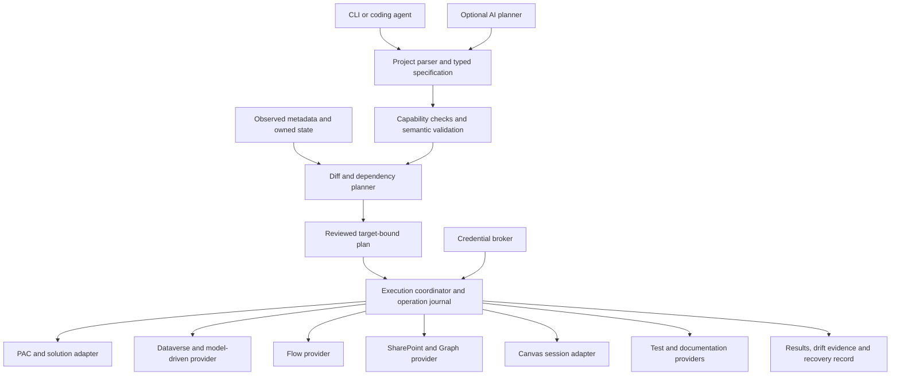

# PowerCanvas: technical and product feasibility

**Research date: 17 September 2026**  
**Decision: proceed with a bounded, supported automation product; do not promise universal, unattended application generation.**  
**Scope: research and proposed design only. No PowerCanvas implementation or tenant changes were performed.**

## Executive summary

PowerCanvas is technically viable as a developer tool that turns a reviewed application specification into a reproducible Power Platform project. Its strongest initial foundation is **Dataverse schema, standard model-driven apps, solution lifecycle management, configuration validation, and controlled deployment**. Add solution-aware cloud flows and SharePoint provisioning through explicit providers. Treat Canvas authoring as a separate, capability-gated workflow.

The technical ceiling is higher than “Power Apps can only be built in a visual editor,” but lower than “every component can be compiled offline and deployed without setup.” Microsoft documents programmatic model-driven app creation and cloud-flow authoring. These provide concrete foundations, not merely evidence that an undocumented endpoint happens to work. [Model-driven app APIs](https://learn.microsoft.com/en-us/power-apps/developer/model-driven-apps/create-manage-model-driven-apps-using-code), [cloud flows through code](https://learn.microsoft.com/en-us/power-automate/manage-flows-with-code).

Canvas has a particularly important new route: Microsoft now documents AI-assisted `.pa.yaml` authoring against a **live Studio coauthoring session**. It requires an existing saved app, an open Studio tab, and Studio-based data-source setup. This can substantially reduce manual screen construction; it does not establish a general headless compiler. [Canvas external authoring, updated 1 September 2026](https://learn.microsoft.com/en-us/power-apps/maker/canvas-apps/create-canvas-external-tools).

The commercial case needs sharper differentiation than the original vision. Microsoft already offers an AI model-app builder, broad Power Platform development plugins, native Git integration, and infrastructure automation. PowerCanvas should compete on **predictable changes across services, preservation of existing work, semantic diffs, reusable modules, security evidence, and recoverable deployments**. Another prompt interface over PAC would have limited defensibility. [Microsoft development plugins](https://github.com/microsoft/power-platform-skills), [model app builder preview](https://learn.microsoft.com/en-us/power-apps/maker/model-driven-apps/model-driven-app-external-tools).

Recommended v0.1: a narrow complaint-management template that produces ordinary Dataverse tables, relationships, forms, views, navigation, and explicit roles; exports and promotes a managed solution; and proves the result with API and browser checks. AI should initially propose a specification. Deterministic code should own compilation and execution.

## 1. Research method and confidence

The attached 60-part brief governs this report. The unrelated construction CRM conversation was excluded following clarification.

This study examines current Microsoft Learn documentation, Microsoft repositories, selected community repositories, package documentation, and comparable developer platforms. Repository metadata was retrieved directly from GitHub on the research date and saved in `repository-evidence.json`. A recent repository push is evidence of repository activity, **not** a guarantee of product support, a release, or a working feature.

No live Power Platform tenant experiments were performed in this study. Consequently:

- **Documented fact** means a cited source explicitly describes a capability or restriction.
- **Engineering assessment** means a conclusion drawn from those documented interfaces.
- **Proposal** means a PowerCanvas design recommendation, not an existing command or Microsoft feature.
- **Unverified** means a claim requires an experiment before it becomes a product commitment.

Support classifications used throughout:

| Label | Meaning |
|---|---|
| Supported | An official API, command, or expressly editable artifact supports the specific operation. |
| Official preview | Microsoft documents the route as preview; availability and contracts can change. |
| Constrained official route | Supported only under stated conditions, such as minor Git edits or an active Studio session. |
| Semi-supported | Report shorthand for an exposed artifact or implementation detail whose general authoring contract is not established. This is not a Microsoft support category. |
| Unsupported | Internal endpoints, explicitly unsupported edits, or retired tooling used as a production dependency. |
| Community | Describes who maintains a tool. Its individual operations can still call supported Microsoft APIs. |

The report deliberately avoids a universal “90% automated” estimate. No controlled benchmark establishes such a percentage. Count completed acceptance criteria for a defined application and record manual interventions; component counts alone can hide the hardest work.

## 2. Discoveries that change the product decision

| Discovery | Evidence and date | Consequence |
|---|---|---|
| Canvas `pack`/`unpack` are deprecated; connector-based `create` is GA. | [PAC Canvas reference](https://learn.microsoft.com/en-us/power-platform/developer/cli/reference/canvas), checked 17 September 2026 | Do not build a new universal compiler around legacy packaging commands. |
| `.fx.yaml` is retired; extracted `.pa.yaml` is principally a review representation. | [Canvas source formats](https://learn.microsoft.com/en-us/power-apps/maker/canvas-apps/power-apps-yaml), updated 23 October 2025 | Keep format provenance and distinguish extraction from supported authoring. |
| Canvas Git edits are restricted; apps with code components have a documented editing limitation. | [Canvas Git integration](https://learn.microsoft.com/en-us/power-platform/alm/git-integration/canvas-apps-git-integration) | A successful text merge is not sufficient validation. |
| Canvas has a live authoring MCP route. | [Canvas plugin architecture](https://github.com/microsoft/power-platform-skills/blob/main/plugins/canvas-apps/AGENTS.md), inspected 17 September 2026 | Investigate assisted creation early, with an explicit session dependency. |
| Microsoft's model-app AI builder already uses an app specification and reviewed build plan. | [Model-app external authoring](https://learn.microsoft.com/en-us/power-apps/maker/model-driven-apps/model-driven-app-external-tools), updated 28 August 2026 | IR plus AI alone is insufficient differentiation. |
| Dataverse formula, calculated, and rollup expressions cannot officially be authored with code. | [Specialized columns](https://learn.microsoft.com/en-us/power-apps/developer/data-platform/specialized-columns) | Import designer-authored components; do not advertise complete schema-expression generation. |
| Test Engine is deprecated effective April 2026. | [Deprecation notice](https://learn.microsoft.com/en-us/power-platform/important-changes-coming#deprecation-of-test-engine) | Prefer direct Playwright and Microsoft's newer samples. |
| ALM Accelerator is deprecated and issues are no longer addressed. | [ALM Accelerator status](https://learn.microsoft.com/en-us/power-platform/guidance/alm-accelerator/overview) | Study its patterns, but do not make it the foundation. |
| PAC now documents `auth token`, specifically for the Power Platform API. | [PAC authentication](https://learn.microsoft.com/en-us/power-platform/developer/cli/reference/auth) | A blanket claim that PAC cannot expose a token is outdated; audience restrictions still matter. |
| Code apps now have a dedicated npm CLI and solution deployment route. | [Power Apps CLI](https://learn.microsoft.com/en-us/power-apps/developer/code-apps/reference/cli), updated 15 September 2026; [ALM](https://learn.microsoft.com/en-us/power-apps/developer/code-apps/how-to/alm) | Consider an optional code-app target for highly custom interfaces. |

Where documentation conflicts, this report uses the most specific restriction and marks the remaining uncertainty. For example, a repository can show recent pushes while a product deprecation notice ends Microsoft maintenance. A README calling a skill “stable” does not override Microsoft Learn describing that feature as preview.

## 3. Platform architecture and automation boundaries

Power Platform is a set of cooperating services. An environment is a deployment and governance boundary; Dataverse supplies the metadata and data foundation for solution-aware applications. It is not a local database that a CLI can reproduce by running arbitrary SQL.

Solutions organize transportable components and dependency information. Unmanaged solutions are the development source; managed solutions introduce managed layers in downstream environments. They do not contain every piece of operational state. User identities, connector credentials, SharePoint content, external services, and many environment-specific bindings need separate handling. [Solution concepts](https://learn.microsoft.com/en-us/power-platform/alm/solution-concepts-alm).

| Component | Relevant representation | Expected automation surface |
|---|---|---|
| Environment | Power Platform service resource, optionally with a Dataverse organization | PAC admin and versioned management APIs |
| Solution and publisher | Dataverse solution records, component membership, exported ZIP | Dataverse solution messages, PAC solution, build tools |
| Dataverse schema | Entity, attribute, choice, relationship, and key metadata | Metadata Web API or .NET SDK |
| Dataverse data | Table rows with IDs, ownership, privileges, and business logic | Dataverse data APIs; separate migration/seed operations |
| Canvas app | Service app record and `.msapp` package, with generated source files | Studio, constrained Git authoring, live authoring MCP, solution transport |
| Model-driven app | AppModule plus component associations and sitemap | AppModule APIs, documented XML, PAC model |
| Forms/views/charts | SystemForm/FormXml; SavedQuery/FetchXML/LayoutXML; visualization definitions | Documented Dataverse APIs and supported customization XML |
| Cloud flow | Solution-aware Process/Workflow row with serialized definition and connection references | Dataverse APIs, solution import/export; evaluate Microsoft's FlowAgent separately |
| Power Pages | Website configuration/data model plus templates, files, content and hosting configuration | PAC pages, supported website ALM, dedicated admin configuration |
| Custom connector | API definition, connection parameters, policy/configuration assets | PAC connector and custom connector tooling |
| Connection | Environment-specific authenticated connector instance | Connector-dependent connection APIs or interactive consent |
| Connection reference | Solution component identifying the connection binding to use | Dataverse/solution settings; does not carry reusable credentials |
| Environment variable | Definition plus default/current value records | Solution definitions and target deployment settings |
| Security | Dataverse roles/privileges, teams, business units, users and application users | Dataverse security APIs plus target identity assignments |
| SharePoint | Separate sites, lists, libraries, fields, content and permissions | Graph, SharePoint REST/CSOM, PnP adapters |

The management API, Dataverse API, Microsoft Graph, SharePoint REST, and connector runtime APIs are separate surfaces. Their tokens, permissions, versions, throttles, and support rules cannot be treated as interchangeable. Microsoft now also exposes a .NET Power Platform management package; its existence does not turn PAC into a public embeddable SDK. [Power Platform API reference](https://learn.microsoft.com/en-us/rest/api/power-platform/).

**Architecture implication:** every operation needs a resource type, owner service, target environment, required identity, support classification, and completion condition. A single global “logged in” flag is inadequate.

## 4. Canvas Apps deep dive

### 4.1 What the files mean

An `.msapp` is a packaged application, not a single YAML document. Studio includes source under `Src`, including an app file, screen files, and component files. Microsoft warns against treating the other internal JSON as stable source. The current source format has explicit control identity/version information and Power Fx property expressions. The brief's `Type: Label` example should be considered **PowerCanvas's proposed high-level schema**, not valid, complete native Canvas source. [Canvas source format](https://learn.microsoft.com/en-us/power-apps/maker/canvas-apps/power-apps-yaml).

PowerCanvas should distinguish five routes:

| Route | What it establishes | Product treatment |
|---|---|---|
| Export/download an existing app and inspect source | Review, documentation, and source-level comparison | Useful early read-only feature |
| Package an existing valid app in a solution | Repeatable transport of a known artifact | Supported deployment feature |
| Native Git integration | Minor repository edits restored through the integration | Constrained edit mode, with compatibility checks |
| Canvas Authoring MCP | Generate, validate, compile and synchronize YAML against a live coauthoring session | Assisted authoring adapter, after a tenant experiment |
| Legacy PASopa/experimental packers or internal package patching | Historical or reverse-engineered construction | Exclude from supported production mode |

The legacy Language Tooling repository redirects to PowerApps-Tooling. Its notice explicitly says PASopa is unsupported and that `--processCanvasApps` uses that legacy tool. The repository also contains newer .NET tooling, so describing the entire repository as abandoned would be inaccurate. The correct distinction is between an active repository and its unsupported legacy path. [PowerApps-Tooling notice](https://github.com/microsoft/PowerApps-Tooling).

### 4.2 The September 2026 authoring route

Microsoft's new workflow generates screen/control/formula YAML, validates it with the authoring service, and synchronizes changes into the existing app. Setup requires .NET 10 or later. The app must be saved and coauthoring enabled; the Studio tab must remain open. Required connectors and data sources are added through Studio's Data panel. [Canvas external authoring](https://learn.microsoft.com/en-us/power-apps/maker/canvas-apps/create-canvas-external-tools).

The plugin exposes `compile_canvas` and `sync_canvas`; its documentation explicitly ties them to that running session. This is substantial evidence that externally generated source can become a working app through an official workflow. It is not evidence that PowerCanvas may invoke undocumented backend operations without the session, or that all tenants and all controls behave identically. [Canvas plugin architecture](https://github.com/microsoft/power-platform-skills/blob/main/plugins/canvas-apps/AGENTS.md).

Recommended product behavior:

1. Detect availability and establish a supported session.
2. Synchronize the current application before editing.
3. Discover actual control and data-source contracts.
4. Generate a small set of changes from typed UI intent.
5. Compile and interpret diagnostics through the documented tool.
6. Preview and test the resulting application.
7. Export a known-good solution artifact for later deployment.

These are proposed orchestration steps. A standalone unattended SDK contract for PowerCanvas has not been verified. Keep the adapter replaceable and report “Studio session required” before making changes.

### 4.3 Git editing is a different contract

Native Git integration supports minor `.pa.yaml` edits. Microsoft advises against significant edits and states that direct editing is unavailable for apps containing code components because it can stop the app from running. This limits a general Git-to-Canvas compiler and affects PCF-heavy design systems. Do not silently route a failed live-authoring operation through repository mutation. [Canvas Git constraints](https://learn.microsoft.com/en-us/power-platform/alm/git-integration/canvas-apps-git-integration).

There is also a narrow GA generator: `pac canvas create` produces an app from an existing solution custom connector with a predefined interface. Microsoft still requires importing into Studio and manually adding the connector reference. This is useful as a connector exerciser, not a general responsive business-app generator. [PAC Canvas create](https://learn.microsoft.com/en-us/power-platform/developer/cli/reference/canvas).

### 4.4 Can a high-level UI schema work?

**Yes, as PowerCanvas's own compiler input.** Its value is semantic consistency and testability. It does not remove the backend authoring restrictions.

Proposed schema fragment:

```yaml
screens:
  requests:
    pattern: master-detail
    data: complaints
    list:
      fields: [title, priority, assignedTo]
      search: {field: title, mode: prefix}
    detail:
      mode: edit
      fields: [title, description, priority, assignedTo]
    states: [loading, empty, error, forbidden]
    responsive: {compact: stacked, wide: split}
```

The compiler must resolve this into concrete control versions, properties, formulas, naming, binding metadata, and navigation. It must reject unsupported combinations instead of inventing properties. Keep separate Canvas, model-driven, and code-app backends; a gallery and a model-driven view do not share identical interaction or security semantics.

### 4.5 Practical UI generation scope

| UI area | Assessment | Needed guardrail |
|---|---|---|
| Screens, navigation, labels, buttons | Strong assisted-authoring candidate | Stable names, navigation graph, runtime validation |
| Containers and responsive layout | Feasible with a bounded pattern library | Explicit width/height, scrolling and compact-layout contracts |
| Galleries and search/filter panels | Feasible; query correctness dominates | Connector-aware delegation checks and realistic datasets |
| Forms and data cards | Feasible but data-type dependent | Required fields, lookup/choice types, attachments and error handling |
| Modern controls | Feasible, version sensitive | Query actual control schema; pin tested versions |
| Variables and collections | Formula generation is practical | Explicit state ownership, initialization, bounded collections |
| Reusable components | Feasible, with import and dependency considerations | Component API/version contracts; distinguish Canvas components from PCF |
| Modal, timeline, command-bar primitives | Feasible only with validated interaction patterns | Keyboard, focus, accessibility and layering verification |
| Arbitrary pixel-perfect screen generation | Technically possible in subsets; no quality guarantee | Visual review and device-specific acceptance criteria |

Modern controls follow Fluent 2, while modern themes centralize appearance. However, Microsoft introduced property and enum changes beginning in February 2026; generators that hard-code historical examples will age poorly. [Modern controls](https://learn.microsoft.com/en-us/power-apps/maker/canvas-apps/controls/modern-controls/overview-modern-controls), [theming](https://learn.microsoft.com/en-us/power-apps/maker/canvas-apps/controls/modern-controls/modern-theming), [2026 control updates](https://learn.microsoft.com/en-us/power-apps/maker/canvas-apps/controls/modern-controls/modern-control-updates).

A design system can improve consistency through spacing, typography, content density, status colors, responsive patterns, and carefully designed empty/error states. “Better than typical Power Apps” is a design hypothesis, not a researched performance fact. Measure task completion, readability, keyboard operation and visual consistency against a hand-built baseline.

Accessibility is a real constraint: arbitrary composite controls and overlays cannot assume unrestricted keyboard or ARIA behavior. Do not make a visually attractive pseudo-button or modal the default without testing its semantics. [Canvas accessibility limitations](https://learn.microsoft.com/en-us/power-apps/maker/canvas-apps/accessible-apps-limitations).

### 4.6 Local development ceiling

Local source editing, schema checks, formula analysis, previews of abstract layouts, and file watching are realistic. Live Canvas synchronization still relies on Microsoft's running authoring environment. A local HTML mockup is useful for design discussion but is not a faithful Canvas runtime or proof of delegation behavior.

Treat `powercanvas dev` as an eventual orchestration command with explicitly different modes: local validation; remote development-environment synchronization; or assisted Canvas editing. Do not promise universal hot reload, local Dataverse, offline connector execution, or a local Power Automate cloud runtime.

## 5. Power Fx generation and analysis

Microsoft's open-source Power Fx repository exposes Core, Interpreter, Connectors, JSON, and LanguageServerProtocol packages. Its hosting samples demonstrate embedding the engine. This supports parser/type-checker and controlled evaluation use cases; it does not supply the entire Power Apps host. [Power Fx repository](https://github.com/microsoft/Power-Fx), [host samples](https://github.com/microsoft/power-fx-host-samples).

| Operation | Feasibility | Boundary |
|---|---|---|
| Parse expressions | High | Pin engine version and locale assumptions |
| Generate expressions | High | Prefer typed expression construction and escaped literals |
| Validate names and types | High for supplied symbols | Canvas controls, record scopes and connector types require host context |
| Format and lint | Feasible engineering work | Preserve comments/source positions; test parse round trips |
| Run pure-expression tests | High | Explicit inputs, deterministic time/culture and supported functions |
| Execute app behaviors locally | Partial | UI state and connector effects are not automatically available |
| Prove all delegation behavior | Not established | Requires host and connector-specific capabilities |
| Compile a full Canvas application | Not provided by these packages | Use the supported app authoring route |

`pac power-fx` currently supplies preview `repl` and `run` commands for interacting with Dataverse. It is not a documented complete offline Canvas linter and can perform data operations. Do not run untrusted generated formulas through it as though it were a harmless parser. [PAC Power Fx](https://learn.microsoft.com/en-us/power-platform/developer/cli/reference/power-fx).

PowerCanvas can provide useful static rules for nested iteration, repeated query expressions, calls inside gallery-item rendering, hard-coded URLs/IDs, overly broad collections, and missing error handling. Classify findings as **definite error**, **connector-specific warning**, or **performance heuristic**. Repeated `LookUp` is a risk signal, not proof of N+1 requests after host optimizations.

Delegation analysis must consider the data source, function, column types and expression context. Nondelegable expressions can process only a limited local subset, so a formula can appear correct in a small test and miss records in production. Build tests above that subset and compare results with a server query. [Delegation overview](https://learn.microsoft.com/en-us/power-apps/maker/canvas-apps/delegation-overview).

## 6. Model-driven apps deep dive

Model-driven applications are easier to generate reliably when their UX fits standard records, forms, views and navigation. Their schema-driven interface removes much of the layout work required for Canvas, while established APIs expose app composition.

The official sequence is to create an AppModule, attach components through `AddAppComponents`, validate with `ValidateApp`, publish with `PublishXml`, and associate access roles. This is a supported route to programmatic app generation, although app validation is not a complete business-function test. [Model-driven app creation API](https://learn.microsoft.com/en-us/power-apps/developer/model-driven-apps/create-manage-model-driven-apps-using-code).

| Component | Generation route | Assessment |
|---|---|---|
| Standard forms | SystemForm and FormXml; copy a valid form or generate a supported structure | High feasibility; preserve IDs and dependencies |
| Views | SavedQuery with FetchXML and layout definitions | High feasibility; validate column names and filters |
| Charts | Documented visualization definitions and solution transport | Feasible; chart-type and field restrictions matter |
| Dashboards | Supported FormXml and component references | Feasible; more composition and layout work |
| App shell and sitemap | AppModule APIs and supported sitemap editing | Strong MVP candidate |
| Classic command/ribbon customizations | Supported RibbonDiffXml patterns | Feasible, but versioned and dependency sensitive |
| Modern commands | Maker authoring and solution transport; further contract validation required | Do not claim a universal raw-source compiler |
| Business process flows | Designer-authored definition; API lifecycle and instance operations | Deploy templates; separate runtime control from definition generation |
| Business rules | Designer-authored rule components; solution transport | Treat arbitrary rule compilation as unverified |
| Custom pages | Canvas-based authoring plus app integration | Inherit relevant Canvas constraints |
| Generative pages | PAC model generation/upload tooling and Microsoft AI workflows | Separate target; gate emerging capabilities |

Microsoft expressly documents programmatic form creation and view customization. It also lists which portions of solution XML may be edited; the fact that other XML is visible does not authorize arbitrary rewriting. Use schema-aware edits within the supported portions. [Forms](https://learn.microsoft.com/en-us/power-apps/developer/model-driven-apps/customize-entity-forms), [views](https://learn.microsoft.com/en-us/power-apps/developer/model-driven-apps/customize-entity-views), [supported XML edits](https://learn.microsoft.com/en-us/power-apps/developer/model-driven-apps/when-edit-customization-file).

The business-process-flow API documentation directs developers to the visual designer to define the process. Its APIs support activation, instances and stage progression. Similarly, a business rule being stored as a workflow category is insufficient evidence for a supported rule compiler. [Business process flows using code](https://learn.microsoft.com/en-us/power-automate/developer/business-process-flows-code), [business rule authoring](https://learn.microsoft.com/en-us/power-apps/maker/data-platform/data-platform-create-business-rule).

Microsoft's model-app plugin is an especially relevant design reference: it builds and edits an App Spec through a vendored headless SDK and can reconcile deployed artifacts. The SDK should be assessed as repository implementation code rather than assumed to be a stable public library. Investigate reuse at a pinned commit and retain a documented API fallback. [Model-app plugin](https://github.com/microsoft/power-platform-skills/blob/main/plugins/model-apps/README.md).

## 7. Dataverse schema and security deep dive

Dataverse can support a declarative schema provider for ordinary custom tables, columns, choices, relationships, keys and selected settings. Metadata APIs expose creation and updates, and `MSCRM.SolutionUniqueName` can associate supported newly created components with the intended solution. Schema creation should happen in a development/build environment before managed promotion. [Table definition APIs](https://learn.microsoft.com/en-us/power-apps/developer/data-platform/webapi/create-update-entity-definitions-using-web-api).

### Proposed supported schema scope

| Area | What PowerCanvas can own | Important distinction |
|---|---|---|
| Tables | Publisher prefix, schema/logical names, primary name, ownership, selected flags | Names and structural choices are not freely mutable |
| Columns | Text, multiline, numeric, currency, date/time, boolean, choice, lookup | Data type, precision, format, time behavior and requiredness must be explicit |
| Choices | Stable integer values plus labels and translations | Renaming a label must not silently renumber existing data |
| Relationships | One-to-many/many-to-one lookup; many-to-many metadata | Specify cascade behavior; validate table eligibility |
| Alternate keys | Defined key metadata and asynchronous readiness checks | Duplicates can prevent successful index creation |
| Auditing | Supported organization/table/column settings | Enabling metadata does not define retention or eliminate storage costs |
| Ownership | User/team or organization ownership where supported | Model access and reassignment behavior before creation |
| Roles | Role records and privilege/depth assignments | Resolve actual privilege metadata; include Append and AppendTo requirements |
| Business units/teams | Target environment provisioning and mappings | Operational identities are not portable role definitions |
| Formula/calculated/rollup columns | Carry designer-authored components through ALM | Do not generate their expression definitions through unsupported code |

Relationship APIs create lookup metadata as part of the relationship definition. They also expose eligibility checks and cascade configuration. This is enough for a deterministic provider, provided the IR captures those semantics. [Relationship APIs](https://learn.microsoft.com/en-us/power-apps/developer/data-platform/webapi/create-update-entity-relationships-using-web-api).

The decisive exception is specialized expressions: Microsoft states that formula/calculated/rollup definitions must be set with the Power Apps editor. Reading `FormulaDefinition`, or discovering its YAML/XAML shape, does not make writing it supported. The MVP should reject such authoring requests with a clear designer step or use a reviewed template component. [Specialized columns](https://learn.microsoft.com/en-us/power-apps/developer/data-platform/specialized-columns).

### Security is part of the generated application

Define permissions by persona, table, action and access depth. Resolve them into platform privileges rather than granting an administrator role to make the application work. Dataverse roles are cumulative, and relationships can require multiple rights. A user may therefore pass the generated role test but retain broader access from another role. [Security concepts](https://learn.microsoft.com/en-us/power-apps/developer/data-platform/security-concepts), [access-right dependencies](https://learn.microsoft.com/en-us/power-apps/developer/data-platform/security-access-rights), [cumulative privileges](https://learn.microsoft.com/en-us/power-platform/admin/security-roles-privileges).

Model app access, Dataverse row access, field security, SharePoint permissions, and flow connection authority are separate checks. Hidden UI fields are not data protection. Use test personas to prove both allowed and denied operations, including direct API access where appropriate.

Standard role templates can be resolved using stable template identities, while role instances and business-unit replicas vary across environments. Custom roles need publisher/solution-aware mappings and target discovery. Never map security using an unqualified display-name match. [Role templates](https://learn.microsoft.com/en-us/power-apps/developer/data-platform/security-roles).

Safe source-controlled material includes schema intent, supported component definitions, role privilege specifications, translations, reviewed seed fixtures, migration instructions and tests. Keep live business data, tokens, target connection credentials and personal identities out of ordinary project source.

## 8. Dataverse migrations

The migration concept is viable, but its semantics differ from Prisma, Entity Framework, Flyway, Liquibase or Supabase SQL migrations. Dataverse evolution combines metadata operations, solution layers, dependency resolution, publishing, asynchronous work, data transformation and potentially external systems. It is not a sequence of arbitrary transactional DDL statements.

Proposed migration classes:

1. **Additive metadata:** introduce a table, optional column, relationship or view.
2. **Behavioral change:** update a form, flow or permission, with regression checks.
3. **Data transformation:** backfill through APIs using resumable checkpoints.
4. **Destructive evolution:** retire and eventually remove a component through a reviewed upgrade.

Adopt an expand/migrate/contract procedure. For a type change, introduce a replacement column, populate and verify it, move readers/writers, then remove the old column only after dependency and data-retention review. Never infer a rename from a deletion/addition pair without explicit intent.

Managed solution **updates** and **upgrades** behave differently: updates do not remove obsolete components, while upgrades can remove components omitted from the new version, subject to dependencies. Uninstalling a managed solution can delete associated custom data. [Solution update and upgrade behavior](https://learn.microsoft.com/en-us/power-apps/maker/data-platform/update-solutions).

A migration record should contain a stable ID, checksum, preconditions, action graph, affected resources, data-loss classification, completion evidence and a forward-recovery procedure. Record both source revision and solution version. Avoid promising a universal `down` migration: removed columns, sent notifications and external side effects may not be reversible.

Use solution transport as the downstream schema authority. Applying the same schema through direct metadata writes in production and through managed imports creates competing ownership and unmanaged layers. Reserve direct operational APIs for explicitly separate data and environment tasks.

## 9. Power Automate deep dive

### Representation and supported authoring

Microsoft documents cloud flows as Process/Workflow rows with category `5`; `clientdata` contains serialized JSON for the definition and connection references. The documented code route applies to solution-aware flows. It supports a practical compiler for a bounded set of triggers/actions. [Cloud flows through code](https://learn.microsoft.com/en-us/power-automate/manage-flows-with-code).

The embedded definition resembles the Logic Apps workflow definition model, but a generic Logic Apps schema is not a complete Power Automate deployment contract. Connector operation IDs, parameters, dynamic metadata, authentication, connection references, ownership and service validation still matter.

For an escalation flow, a useful IR must go beyond “notify manager.” It should define:

- The triggering table and event, filtering columns and trigger conditions.
- How the assigned manager is resolved and what happens if none exists.
- Stable action IDs, explicit dependencies and branch/scope structure.
- Typed inputs and outputs, expression references and null handling.
- An idempotency or deduplication strategy.
- Retry policy, timeout, concurrency and failure reporting.
- Connection references, owner identity and intended enablement state.

Without those details, natural-language generation merely moves ambiguity into production.

### Recommended compiler approach

Start with a curated connector/action catalog: Dataverse trigger, retrieve/update row, condition, scope, recurrence, and one notification connector. Store tested operation metadata and sample artifacts. Resolve environment-specific values late. Validate the graph and expression references locally; then create the flow disabled in a test environment, bind connections, validate activation and run representative scenarios.

Microsoft now publishes a Power Automate plugin powered by FlowAgent MCP. It advertises creation, surgical edits, run diagnostics, connection operations, scaffolding and validation. This makes it a serious competitor and potential adapter. Its bundled engine and authentication requirements must be assessed operation by operation; a Microsoft repository alone is not evidence that every underlying endpoint is a public third-party contract. Its “offline” description concerns the local engine packaging, not offline execution of cloud flows. [Power Automate plugin](https://github.com/microsoft/power-platform-skills/blob/main/plugins/power-automate/README.md).

### Reliability and authentication

A connection reference identifies which authenticated connection a component uses. Binding it does not authenticate that connection. The identity enabling a flow must own or have permission to use the relevant connections; importing a valid flow can therefore succeed while activation fails. [Connection reference activation rules](https://learn.microsoft.com/en-us/power-apps/maker/data-platform/create-connection-reference).

Connector support for service principals varies. OAuth consent, MFA, delegated-user authority, external tenant restrictions and connection repair can require human action. PowerCanvas must distinguish deployment identity, flow owner, connection owner and run identity.

Premium service-principal-owned flows need a supported licensing arrangement. Current documentation includes Process/per-flow capacity, an appropriately licensed flow group, or a designated licensed user's entitlement. Do not repeat the outdated blanket claim that a Process license is always the only option. [Service-principal flow support](https://learn.microsoft.com/en-us/power-automate/service-principal-support), [designated user licensing](https://learn.microsoft.com/en-us/power-automate/assign-user-license-service-principal-flow).

PowerCanvas should treat “artifact created,” “connections ready,” “flow enabled,” and “behavior verified” as separate milestones. Designer-editability is an additional round-trip acceptance criterion.

## 10. SharePoint and Microsoft Graph deep dive

SharePoint provisioning is highly automatable, but it lives outside the Power Platform solution boundary. Include it in the deployment graph as separately owned infrastructure, with its own state and recovery plan.

| Resource/action | Preferred route | Boundary |
|---|---|---|
| Discover sites, lists, users and groups | Graph | Requires appropriate directory/site permissions |
| Create ordinary lists and columns | Graph v1.0 where covered | Validate requested field types and update restrictions |
| Create document libraries | List/library provisioning through supported Graph or SharePoint APIs | Test the exact template and settings |
| Files, folders and metadata | Graph drive/list-item APIs | Large uploads and metadata operations have different mechanics |
| Modern communication or non-group team site | SharePoint site-creation REST or PnP | Tenant creation policy and elevated bootstrap permissions |
| Microsoft 365 group-connected team site | Graph group-backed provisioning or PnP | Provisioning is asynchronous and creates additional resources |
| Content types and site columns | Graph where sufficient; SharePoint/PnP for richer operations | Do not assume full feature parity |
| Views, indexing, versioning and complex list settings | SharePoint REST/CSOM or PnP | More complete SharePoint-specific model |
| Permission inheritance and SharePoint groups | SharePoint/PnP; Graph for supported permission operations | Site grants, file sharing and user permissions are distinct |

Graph v1.0 explicitly supports creating lists with custom columns. A direct site-creation operation was found in **Graph beta**; this study did not establish a corresponding supported v1.0 route for that operation. Use documented SharePoint site APIs or group-based provisioning instead of assuming either “Graph cannot create sites” or “Graph beta is production-supported.” [Graph list creation](https://learn.microsoft.com/en-us/graph/api/list-create?view=graph-rest-1.0), [Graph beta site creation](https://learn.microsoft.com/en-us/graph/api/site-post-sites?view=graph-rest-beta), [SharePoint site REST](https://learn.microsoft.com/en-us/sharepoint/dev/apis/site-creation-rest).

PnP PowerShell and PnP Core provide substantial coverage and can reduce development effort. Core transparently uses Graph and SharePoint APIs. They are community-maintained libraries without a Microsoft support SLA; validate the actual operation and pin dependencies. [PnP Core support](https://pnp.github.io/pnpcore/), [PnP site creation](https://pnp.github.io/powershell/cmdlets/New-PnPSite.html), [PnP authentication](https://pnp.github.io/pnpcore/using-the-sdk/configuring%20authentication.html).

Use selected-resource permissions where sufficient. Consent to a Selected scope does not by itself grant access to every resource; resource-specific grants are part of the authorization model. Site creation needs a separate bootstrap capability because access to an existing selected site cannot authorize creating arbitrary new sites. [Selected permissions](https://learn.microsoft.com/en-us/graph/permissions-selected-overview).

Do not use SharePoint ACS app-only authentication. Microsoft set its final retirement for 2 April 2026. Use Entra-based authentication and the credentials supported by the chosen API. [ACS retirement](https://learn.microsoft.com/en-us/sharepoint/dev/sp-add-ins/retirement-announcement-for-azure-acs).

Graph also belongs in PowerCanvas for identity/group lookup, approved membership operations, OneDrive files and selected Teams integration. It should not be used as a substitute for Dataverse metadata or Power Platform environment APIs. Avoid broad directory-write permissions unless an explicitly requested module needs them.

## 11. Power Pages and code apps

Power Pages is a feasible later target for templated portals and code sites. PAC provides website list/download/upload, cloning, model migration, and code-site upload/download operations. Templates, JavaScript, CSS, Liquid and supported site configuration can be source controlled. Website provisioning, identity providers, domains, certificates and external-user access need dedicated lifecycle handling. [PAC pages](https://learn.microsoft.com/en-us/power-platform/developer/cli/reference/pages).

Do not mistake the portal's `/_api` for a provisioning API. Microsoft restricts that API to supported data operations and explicitly excludes table metadata and portal configuration tables. Configure sites through the documented management and ALM routes. [Power Pages Web API restrictions](https://learn.microsoft.com/en-us/power-pages/configure/web-api-overview).

Power Apps **code apps** deserve an additional target in the product strategy. They support framework-based development such as React/Vue, local code development and Power Platform hosting/connectors. End users need Power Apps Premium. Their limitations include no native Power Platform Git integration and no SharePoint forms integration; ordinary source Git remains a separate concern. [Code apps overview](https://learn.microsoft.com/en-us/power-apps/developer/code-apps/overview).

The newer `pa` CLI initializes, runs and publishes code apps. Its ALM route can place an app into a Dataverse solution. This offers a better fit for custom code-generated UI when Canvas-specific capabilities are not essential, but it is a different artifact type and must not be marketed as Canvas generation. [Code-app quickstart](https://learn.microsoft.com/en-us/power-apps/developer/code-apps/how-to/npm-quickstart), [code-app ALM](https://learn.microsoft.com/en-us/power-apps/developer/code-apps/how-to/alm).

## 12. Existing Microsoft tooling: wrap versus build

### PAC command coverage

This inventory covers the requested groups and important newer additions. Commands are documented interfaces; their exact options must be checked against the version selected for PowerCanvas.

| Group | Relevant functionality | Recommendation |
|---|---|---|
| [`pac auth`](https://learn.microsoft.com/en-us/power-platform/developer/cli/reference/auth) | Profiles, interactive/device sign-in, service principals, certificate/federated/managed-identity options, identity inspection | Wrap PAC's own authentication; use a separate supported credential provider for direct APIs |
| [`pac env`](https://learn.microsoft.com/en-us/power-platform/developer/cli/reference/env) | Organization discovery, selection, identity and settings operations | Prefer explicit target parameters and JSON where documented |
| `pac org` | Historical command name in older examples | Use the current `env` reference as the baseline; do not promise alias compatibility without checking the installed CLI |
| [`pac solution`](https://learn.microsoft.com/en-us/power-platform/developer/cli/reference/solution) | Init/clone/sync, export/import, pack/unpack, component membership, settings generation, checker, versioning, publish/upgrade | Primary packaging and ALM adapter |
| [`pac canvas`](https://learn.microsoft.com/en-us/power-platform/developer/cli/reference/canvas) | List/download, narrow connector generator, deprecated pack/unpack | Use inspection and narrowly documented operations |
| [`pac modelbuilder`](https://learn.microsoft.com/en-us/power-platform/developer/cli/reference/modelbuilder) | Generates strongly typed Dataverse code from existing metadata | Reuse for developer types; it does not generate the database schema |
| [`pac power-fx`](https://learn.microsoft.com/en-us/power-platform/developer/cli/reference/power-fx) | Preview expression REPL and script execution | Optional expert tool, not the lint foundation |
| [`pac application`](https://learn.microsoft.com/en-us/power-platform/developer/cli/reference/application) | Lists/installs available Dataverse marketplace applications | Dependency installation; not an arbitrary app generator |
| [`pac connector`](https://learn.microsoft.com/en-us/power-platform/developer/cli/reference/connector) | Create/update/download/list/delete custom connectors and related operations | Wrap supported connector lifecycle |
| [`pac plugin`](https://learn.microsoft.com/en-us/power-platform/developer/cli/reference/plugin) | Dataverse plug-in project scaffolding and package operations | Reuse if server-side extensions enter scope |
| [`pac package`](https://learn.microsoft.com/en-us/power-platform/developer/cli/reference/package) | Package projects, solutions/data/configuration and deployment | Later complex installer support; unnecessary for the first simple solution |
| [`pac admin`](https://learn.microsoft.com/en-us/power-platform/developer/cli/reference/admin) | Environment lifecycle, backups/restores, service principals, settings and discovery | Separate privileged provider; exclude destructive administration from default workflow |
| [`pac pcf`](https://learn.microsoft.com/en-us/power-platform/developer/cli/reference/pcf) | Code component initialization/versioning and development deployment | Reuse PCF tooling and harness; build components independently |
| [`pac connection`](https://learn.microsoft.com/en-us/power-platform/developer/cli/reference/connection) | List/create/update/delete connection operations | Connector-specific readiness checks remain necessary |
| [`pac model`](https://learn.microsoft.com/en-us/power-platform/developer/cli/reference/model) | App creation/listing, table discovery, generative-page type generation/upload/download | Prefer these documented commands over custom equivalents when adequate |
| [`pac pages`](https://learn.microsoft.com/en-us/power-platform/developer/cli/reference/pages) | Website content and code-site lifecycle | Later Power Pages provider |
| `pac pipeline` | Native deployment pipeline integration | Integrate with an existing enterprise pipeline rather than forcing replacement |
| New management groups | Environment management, governance, licensing, resource queries and others, many marked preview | Capability-gate each operation; avoid freezing an obsolete inventory |

The command-group index was updated on 11 September 2026. It includes substantially more than the brief's original list. Treat this as a moving platform surface with tested adapters, not a one-time shell wrapper. [Current PAC index](https://learn.microsoft.com/en-us/power-platform/developer/cli/reference/).

### Is PAC suitable for orchestration?

**Yes, with a versioned adapter.** Documented JSON output exists for operations such as `env who`, `solution list` and several admin commands. It is not a demonstrated universal output contract for every command. Read exit codes, use structured files where provided, retain sanitized diagnostics, and follow long-running operation status. Do not parse decorative console tables as the main state API.

Proposed wrapper requirements:

- Resolve and verify the intended executable; pin a tested version and distribution.
- Invoke with an argument array, never shell-interpolate user prompts.
- Set tenant/environment explicitly and verify identity before writes.
- Separate progress output from machine-readable results.
- Enforce timeouts while distinguishing timeout from server-side failure.
- Serialize commands that mutate shared authentication selection.
- Redact tokens, connection payloads and sensitive errors.
- Run compatibility probes when upgrading PAC; do not auto-update production runners mid-release.

PAC is distributed in several forms, with platform differences. For cross-platform usage, verify the selected .NET-tool capabilities on Windows, macOS and Linux rather than assuming Windows-only package features work everywhere. [PAC installation](https://learn.microsoft.com/en-us/power-platform/developer/cli/introduction).

Use the Dataverse .NET SDK, Web API, Graph SDKs, Power Fx libraries, and Power Platform management SDK where they expose the required public contract. Do not reflect into PAC's private assemblies. Standard process invocation is a reasonable dependency model; bundling or redistributing Microsoft binaries needs a separate license review before release. [Dataverse SDK choice](https://learn.microsoft.com/en-us/power-apps/developer/data-platform/work-with-data), [management API and SDK](https://learn.microsoft.com/en-us/rest/api/power-platform/).

## 13. ALM, packaging and deployment

The proposed `powercanvas deploy production` workflow is feasible once target prerequisites exist. It should coordinate the following phases:

1. **Resolve:** load immutable artifact, target configuration, intended identity and release policy.
2. **Preflight:** verify privileges, dependencies, connector availability, bindings and migration risk.
3. **Validate:** run local structural checks, supported platform checks and relevant tests.
4. **Prepare:** verify a usable recovery point where required; provision separately owned external resources.
5. **Import:** import the managed solution with target deployment settings and monitor completion.
6. **Configure:** finish target-specific assignments, reference bindings and approved data operations.
7. **Activate:** enable flows only when dependencies and connection authority are ready.
8. **Verify:** run identity-specific smoke tests and record component/solution versions.

Deployment settings can prepopulate environment variables and connection-reference bindings, eliminating interactive import prompts for those values. They do not create valid OAuth consent or replace connection ownership checks. Generate settings from the actual solution and validate them against the target. [Deployment settings](https://learn.microsoft.com/en-us/power-platform/alm/conn-ref-env-variables-build-tools).

Power Platform Build Tools and GitHub Actions already automate much of solution export, build, checks and deployment. Build Tools version 2 is PAC-based. PowerCanvas's value is the coherent project/plan/configuration layer above these primitives and coordination with SharePoint and other resources. [Azure DevOps Build Tools](https://learn.microsoft.com/en-us/power-platform/alm/devops-build-tools), [GitHub Actions repository](https://github.com/microsoft/powerplatform-actions).

Prefer creating a valid managed artifact through the supported solution build/export path. Do not assume that flipping an unmanaged ZIP's flag produces an equivalent managed build. For metadata generated from intent, first materialize and validate it in an isolated development/build environment, then export through the platform. Existing valid source projects can use the supported pack/build workflow.

Promote the same artifact through Test/UAT and Production; vary only declared target configuration. Record SHA-256, solution version, source commit, generator versions and validation results. An identical build need not produce a byte-identical server export; compare normalized semantic content as well as the hash of the specific artifact promoted.

Native pipelines support staged deployment, integrations and redeploying a prior solution version when configured. That is useful recovery, but it is not a guarantee that deleted data or external side effects are restored. [Power Platform pipelines](https://learn.microsoft.com/en-us/power-platform/alm/pipelines).

## 14. Infrastructure as code, state and semantic diffs

### A bounded declarative model is realistic

PowerCanvas can compare desired application intent with observed platform metadata and produce a plan. It cannot safely infer that every resource absent from a project should be deleted. Applications share tables, connections, roles and libraries; unmanaged layers and service-generated metadata complicate ownership.

Use a three-way comparison: **desired specification**, **last applied ownership/baseline**, and **current observed state**. A resource can be created, updated, adopted, left unmanaged, or marked as conflicting. Importing an existing app into PowerCanvas should start read-only and require explicit adoption of the fields or components it may manage.

Proposed ownership rules:

- Own selected properties, not automatically the entire environment.
- Keep native artifacts for components the IR cannot fully represent.
- Preserve unknown fields and opaque components during round trips.
- Identify objects with stable logical names and recorded target IDs.
- Show dependency-driven changes and destructive operations separately.
- Re-read immediately before applying a saved plan and reject stale assumptions.

Microsoft already has a Terraform provider for environments and other Power Platform resources. Use it for infrastructure already well covered rather than maintaining a competing provider for every admin operation. PowerCanvas can consume its outputs. [Microsoft Terraform provider](https://github.com/microsoft/terraform-provider-power-platform).

### State storage recommendation

| Option | Benefits | Limitations | Recommended use |
|---|---|---|---|
| Local state | Simple, offline-readable | Poor collaboration and locking | Single-developer prototype |
| Git only | Reviewable desired state and history | Unsafe place for secrets; weak runtime locking and journals | Source and immutable manifests, not live shared state |
| Azure Blob | Versioning, access controls, leases for coordination | Azure setup and operational ownership | Preferred team-state backend if building state management |
| Dataverse state table | Co-located with deployment resources | Circular bootstrap, licensing and environment-restore coupling | Optional later backend, outside the application's managed solution |
| Live introspection only | Fresh observed metadata | Cannot reliably infer ownership, intent or completed migration history | Necessary input, insufficient alone |
| Existing Terraform/Pulumi backend | Mature state workflows | Only applies to resources managed by that engine | Prefer reuse for infrastructure provider scope |

Terraform's state associates configuration with real resources and retains metadata needed for planning; its plan can be saved for application. Borrow these concepts, while recognizing Power Platform's shared components and asynchronous service operations. [Terraform state](https://developer.hashicorp.com/terraform/language/state), [saved plans](https://developer.hashicorp.com/terraform/cli/commands/plan).

State should contain IDs, ownership, hashes, versions, operation checkpoints and drift evidence. Store credentials elsewhere. If a service returns a secret in a resource payload, filter it before state persistence. Remote state and backups still need encryption and tightly controlled access.

### Semantic diff feasibility

| Area | Useful diff | Limit |
|---|---|---|
| Tables/columns/relationships | Adds, property changes, cascade changes, key changes | Normalize defaults, labels and environment-specific identifiers |
| Security roles | Privilege/action/depth changes | Effective user access also depends on all roles, teams and sharing |
| Forms/views | Tabs, sections, fields, order, FetchXML filters | Preserve meaningful IDs and order; avoid destructive normalization |
| Flows | Trigger/action/condition/dependency changes | Connector metadata and expression semantics need interpretation |
| Canvas | Screens/controls/properties/formulas from supported source | Visible source may be incomplete; binary equality is unhelpful |
| Environment configuration | Declared settings and binding references | Hidden or inaccessible settings must remain “unknown” |
| SharePoint | Lists, fields, views and selected settings/permissions | Operational content and external grants are separate |

`powercanvas diff dev production` should compare equivalent layers or release artifacts plus configuration. Comparing a dev unmanaged layer directly with production's effective managed stack can produce misleading differences. Return unresolved comparisons explicitly instead of reporting “no drift.”

## 15. Validation, static analysis and testing

Use layered validation with separate evidence, not one green badge:

| Layer | Examples | What success does not prove |
|---|---|---|
| Specification | Required properties, unique IDs, supported types, reference resolution | Platform acceptance |
| Static semantic checks | Formula parse/types with known symbols, query patterns, flow dependency graph | Runtime data behavior |
| Target preflight | Permissions, configuration, connections, dependencies, DLP visibility | Successful execution under every user |
| Platform checks | Solution Checker, ValidateApp, supported authoring diagnostics | End-to-end business correctness |
| Deployment verification | Imported version, published components, enabled flows | Correct user access and integrations |
| API integration tests | CRUD, lookup association, invalid-input rejection, denied access | Visual usability |
| Browser tests | Main user journeys, errors, navigation, responsive layouts | Arbitrary unseen requirements |
| Flow behavior tests | Trigger, branch, timeout, retry, duplicate-event handling | Every external service failure mode |

Solution Checker is an appropriate integration, with its documented component coverage and rule output. Keep results tied to a specific artifact and ruleset; do not treat it as a universal flow, license, security or UI verifier. [Solution Checker](https://learn.microsoft.com/en-us/power-apps/maker/data-platform/use-powerapps-checker).

Important static-analysis nuances:

- Circular business relationships can be valid. Report problematic dependency or cascade cycles, not every graph cycle.
- Flag a missing target column when a parsed reference proves it; mark dynamically constructed references as uncertain.
- Hard-coded URLs, IDs and email addresses are portability risks, but some are intentional constants.
- Flow depth, connector count and fan-out are useful cost/performance signals; actual request volume depends on runtime data and retries.
- Licensing checks should identify requirements and unresolved entitlement evidence, not issue a blanket compliance certificate.

**Testing recommendation:** use direct Playwright with Microsoft's Power Platform Page Object Model samples. They provide Canvas/model-driven/generative-page abstractions, reusable authentication state and CI patterns. The sample toolkit is a starting point to adapt and pin, not proof that every custom control works automatically. [Power Platform Playwright samples](https://learn.microsoft.com/en-us/power-platform/developer/playwright-samples/overview).

Test Engine should not be a new dependency because Microsoft deprecated it in April 2026. Its repository was still reachable and showed recent push activity during this research; the explicit deprecation notice takes precedence. EasyRepro remains useful context for older Dynamics test suites, but repository metadata showed its most recent push in October 2024. [Test Engine deprecation](https://learn.microsoft.com/en-us/power-platform/important-changes-coming#deprecation-of-test-engine), [EasyRepro](https://github.com/microsoft/EasyRepro).

Use dedicated test identities, short-lived protected browser state, and policy-compatible sign-in. API authentication with a service principal does not automatically supply an interactive user's browser session. Run security tests as low-privilege personas rather than only as the deployment administrator.

## 16. Authentication and multi-tenant strategy

### Credential architecture

Use a credential broker with explicit tenant, cloud, account/application and resource audience. For interactive use, prefer browser sign-in through supported Microsoft identity libraries; offer device code where tenant policy permits. For CI, prefer workload federation or managed identity where the target operation supports them, then certificates. Client secrets are a fallback, never project configuration.

PAC supports named profiles and several unattended methods. It also documents `pac auth token`, which returns a **Power Platform API** token. It is reasonable to evaluate that explicit command for that audience. Do not scrape PAC's internal cache or assume its token works for Dataverse, Graph or SharePoint. Use the correct credential acquisition route per service. [PAC auth](https://learn.microsoft.com/en-us/power-platform/developer/cli/reference/auth).

MSAL's supported persistence extensions provide a better foundation than a custom plaintext token file. Node extensions and .NET extensions support protected cross-platform persistence. Keep tenant/account separation in cache keys and fail clearly when secure persistence is unavailable; an ephemeral session is preferable to silently falling back to unprotected storage. [MSAL Node extensions](https://learn.microsoft.com/en-us/entra/identity-platform/msal-node-extensions), [.NET token persistence](https://learn.microsoft.com/en-us/entra/msal/dotnet/how-to/token-cache-serialization).

| Service | Identity/authorization considerations |
|---|---|
| Dataverse | Environment URL/audience, application-user presence, appropriate security role |
| Power Platform administration | Management permissions and API-specific roles/registration |
| Microsoft Graph | Delegated/application permissions and consent; directory scopes only when required |
| SharePoint | SharePoint resource audience and supported Entra app-only/delegated method |
| Connectors | Connector-specific identity, consent, ownership and sharing |
| Canvas authoring | Supported local authoring authentication plus live Studio session |
| Browser tests | An actual permitted test-user session and relevant app access |

Legacy Power Platform admin service-principal registration can imply very broad administration. Do not confuse that mechanism with an ordinary least-privilege Dataverse application user or newer scoped management permissions. Isolate tenant bootstrap/admin work from routine application deployment. [Admin service-principal model](https://learn.microsoft.com/en-us/power-platform/admin/powerplatform-api-create-service-principal).

### Multi-tenant profiles

Store a nonsecret profile containing alias, tenant ID, cloud, allowed environments and preferred authentication mechanism. Bind project environments to immutable IDs; display names are for people. A profile switch must show both tenant and environment before a mutation, and each operation should capture the resolved target rather than consult a mutable global default halfway through.

Proposed commands:

```text
powercanvas auth add client-a
powercanvas auth add client-b
powercanvas auth list
powercanvas env use client-a/dev
powercanvas doctor --env client-a/dev
```

Use separate deployment identities and state namespaces per client. Lock or isolate PAC profile selection during parallel work. In CI, select one explicit target for the job and reject accidental tenant mismatches. Support national-cloud endpoints as separately tested capability profiles, not a string replacement on commercial URLs.

## 17. Environment configuration, licensing and governance

Environment discovery and administration are technically feasible through PAC and Power Platform management APIs. Creation/provisioning is asynchronous and subject to permissions, capacity, geography and tenant policy. Default language, currency, region and environment type are architectural inputs, not harmless afterthoughts. [PAC admin](https://learn.microsoft.com/en-us/power-platform/developer/cli/reference/admin).

Environment variable definitions belong with solution intent; current values belong to target configuration. Secret variables should reference an approved secret store where supported. A committed `.env` file is not an adequate replacement. Distinguish a missing value from an intentionally empty value. [Environment variables](https://learn.microsoft.com/en-us/power-apps/maker/data-platform/environmentvariables).

### Licensing implications

| Architecture | Likely licensing consideration | What the CLI should report |
|---|---|---|
| Canvas + SharePoint + standard connectors | Existing Microsoft 365 rights may cover qualifying use | Verify actual plan and connector classification |
| Full Dataverse/model-driven application | Premium Power Apps or applicable Dynamics rights | Required app/data entitlements and target-user checks |
| SQL or custom connectors | Premium connector requirements are likely | Flag before architecture approval |
| Standalone premium cloud flows | Power Automate entitlement depends on flow and execution model | Separate flow licensing from app licensing |
| Service-principal-owned flows | Explicit supported licensing arrangement | Owner, connection authority and licensing source |
| Power Pages | Authenticated/anonymous capacity and site licensing | External-user volume assumptions and capacity model |
| Code apps | Power Apps Premium for users | State this when offering the alternative UI target |
| Developer environment | Development/test rights and limited capacity | Do not imply production entitlement |

The licensing model changes and has exceptions. The CLI can maintain a versioned rule catalog and show evidence from current guidance, but cannot infer every contractual right from the API or installed licenses. Treat missing evidence as “needs review,” not “compliant.” [Power Platform licensing FAQ](https://learn.microsoft.com/en-us/power-platform/admin/powerapps-flow-licensing-faq), [Power Automate FAQ](https://learn.microsoft.com/en-us/power-platform/admin/power-automate-licensing/faqs), [Developer Plan](https://learn.microsoft.com/en-us/power-platform/developer/plan).

DLP can prevent a connector combination even when every connection is valid. Policies classify connectors, restrict combinations and can impose further endpoint/action constraints. Governance also includes environment creation restrictions, managed-environment rules, sharing limits, Conditional Access and service-principal permissions. A preflight check with insufficient admin visibility must report the gap. [Connector classification](https://learn.microsoft.com/en-us/power-platform/admin/dlp-connector-classification), [data policies](https://learn.microsoft.com/en-us/power-platform/admin/prevent-data-loss).

Custom connectors are feasible reusable artifacts, but require both API definition/configuration and a functioning backend. The documented OpenAPI import route requires Swagger/OpenAPI 2.0 and rejects 3.0. PowerCanvas may offer a conversion step only with explicit loss/compatibility validation; it should not accept any OpenAPI document and promise a working connector. [Custom connector definition requirements](https://learn.microsoft.com/en-us/connectors/custom-connectors/define-openapi-definition).

## 18. Security and disaster prevention

| Threat | Secure default |
|---|---|
| Credential leakage | OS-protected cache, redacted logs, no tokens in prompts, state or Git |
| Wrong tenant/environment | Immutable target IDs, identity verification, environment protection |
| Excessively privileged app | Separate bootstrap, deployment and runtime identities; minimal roles |
| Malicious template/plugin | Pinned versions/digests, provenance, declared capabilities and explicit installation |
| Prompt injection in existing app metadata | Treat retrieved names, descriptions and files as data; constrain AI output to a validated schema |
| AI-generated exfiltration or damaging actions | Connector/action allowlists, destination review and deterministic policy checks |
| Hidden destructive migration | Explicit data-loss classification and saved-plan approval |
| Compromised release runner | Federated short-lived credentials, protected release environment and audit trail |
| Private data sent to an AI provider | Metadata-only context by default; explicit opt-in for sample/business data |
| Plugin process with full access | Process isolation plus OS/container controls where needed; process boundaries alone are not a sandbox |

Production apply should require an approved, target-bound plan, a protected execution identity, verified artifact hash and fresh preconditions. Add a lock, a durable operation journal, bounded retries, and postcondition checks. A `--yes` flag should mean consent to a reviewed plan, not permission to bypass every protection.

Recovery must be designed per operation:

- Reimport/redeploy a previously tested artifact for supported metadata rollback, subject to version/layer constraints.
- Prefer forward fixes for failed data migrations with resumable checkpoints.
- Use environment backups for appropriate environment-wide recovery, with documented restore restrictions.
- Recover SharePoint and external systems with their own procedures.
- Never claim a solution export is a backup of all business data or connector credentials.

Microsoft's backup documentation restricts restore targets and regions and describes post-restore connection repair. Canvas app identifiers can also differ after restore. A recovery plan must therefore include rebinding and smoke testing, not merely requesting a restore. [Backup and restore restrictions](https://learn.microsoft.com/en-us/power-platform/admin/backup-restore-environments).

An imported solution, a SharePoint library and a sent email do not share one transaction. Use a staged deployment with compensating actions where safe, and manual recovery instructions for irreversible effects. Do not promise atomic rollback across the platform.

## 19. Performance and throttling

Dataverse distinguishes service-protection throttles from licensed request entitlements. Documented protection dimensions include request count, combined execution time and concurrent requests; the usual published values include 6,000 requests and 1,200 seconds of execution in a five-minute window, plus a concurrency threshold of 52 or higher. They are not a throughput promise for every operation or tenant. [Dataverse service protection](https://learn.microsoft.com/en-us/power-apps/developer/data-platform/api-limits), [limit categories](https://learn.microsoft.com/en-us/power-apps/maker/data-platform/api-limits-overview).

Implement an independent queue per service/tenant/environment/identity. Honor `Retry-After`, add jitter where appropriate, reduce concurrency on throttling and use checkpointed retries. Retry reads and demonstrably idempotent writes; reconcile a timed-out create before attempting it again. Store server operation IDs for long-running imports and provisioning.

Graph batches do not exempt individual requests from throttling. SharePoint uses its own resource and application limits. Power Automate has flow-specific limits, concurrency and connector behavior. Keep these separate in telemetry and preflight estimates. [Graph throttling](https://learn.microsoft.com/en-us/graph/throttling), [SharePoint throttling](https://learn.microsoft.com/en-us/sharepoint/dev/general-development/how-to-avoid-getting-throttled-or-blocked-in-sharepoint-online), [flow limits](https://learn.microsoft.com/en-us/power-automate/limits-and-config).

Cache metadata with version-aware invalidation and request only required fields. Batch compatible reads and data operations, but keep dependency-sensitive schema creation ordered. Optimize round trips and unnecessary exports before optimizing implementation-language speed.

## 20. Existing tools and competitor analysis

Activity below is a snapshot, not a maintenance guarantee. “Recent” means repository push activity observed in 2026. Some repositories contain multiple languages; the table describes the implementation relevant to this decision. Tool feature claims come from the linked project documentation and have not been benchmarked in this study.

| Tool/project | Architecture and language | Activity/support | Strengths and useful patterns | Gap or reason not to build directly on it |
|---|---|---|---|---|
| [PAC](https://learn.microsoft.com/en-us/power-platform/developer/cli/reference/) | Microsoft CLI and service adapters | Current official tooling | Broad lifecycle primitives and ecosystem standard | Does not supply PowerCanvas's complete owned desired-state model |
| [Power Platform Skills](https://github.com/microsoft/power-platform-skills) | JavaScript/TypeScript scripts, skills, MCP engines, PAC integration | Recent, Microsoft; individual features vary in maturity | Natural-language authoring, specs, validation and existing-solution edits | Strong direct overlap; evolving contracts and service prerequisites |
| [Model-app plugin](https://github.com/microsoft/power-platform-skills/blob/main/plugins/model-apps/README.md) | App Spec plus vendored headless SDK, Node | Recent; Learn calls builder preview | Existing proof of spec-to-app architecture | Do not adopt internal SDK as a stable public API without evaluation |
| [FlowAgent plugin](https://github.com/microsoft/power-platform-skills/blob/main/plugins/power-automate/README.md) | Local Node MCP bundle and cloud service operations | Recent, Microsoft repository | Flow editing and diagnostics | Validate support per underlying operation and version |
| [Terraform Power Platform provider](https://github.com/microsoft/terraform-provider-power-platform) | Go, Terraform provider framework | Recent, Microsoft; selected resources preview | Environment/admin desired state and drift model | Not a universal business-app UI compiler |
| [Pulumi Power Platform](https://github.com/rpothin/pulumi-powerplatform) | Native Python provider using management SDK and experimental provider framework | Recent, community | Programmable environment/governance resources | README lists incomplete import/retry work; not simply Microsoft's Terraform provider bridged to Pulumi |
| [CLI for Microsoft 365](https://github.com/pnp/cli-microsoft365) | TypeScript, cross-platform command surface | Recent, community/PnP | Microsoft 365/SharePoint coverage and scriptable UX | Audit per-command APIs; not a full app compiler |
| [PnP PowerShell](https://github.com/pnp/powershell) | PowerShell interface with C# implementation | Recent, community | Extensive SharePoint provisioning | Runtime/dependency footprint; no Microsoft support SLA for the library |
| [PnP Core SDK](https://github.com/pnp/pnpcore) | .NET object model over Graph/SharePoint | Recent, community | Rich provider implementation foundation | Additional abstraction and version compatibility work |
| [XrmToolBox](https://github.com/MscrmTools/XrmToolBox) | C# desktop host with plugins | Recent, community | Broad practical Dataverse administration and customization | GUI-first; plugin support/licenses vary; host GPL-3.0 |
| [DLaB tools](https://github.com/daryllabar/DLaB.Xrm.XrmToolBoxTools) | C# plugins and generation logic | Recent, community | Early-bound generation and reusable logic organization | Extract reusable logic only under applicable licenses; GUI workflow is not CLI architecture |
| [XrmDefinitelyTyped](https://github.com/context-and-oss/XrmDefinitelyTyped) | Typed client-code generation, F#/TypeScript-related code | Recent, community | Generates TypeScript declarations from existing metadata | Generates developer types, not application schema or UX |
| [spkl within SparkleXrm](https://github.com/scottdurow/SparkleXrm/tree/master/spkl) | C# task/deployment tooling | Repository last push August 2024 | Simple project-oriented deployment patterns | Older stack; test compatibility before reuse |
| [xRM CI Framework](https://github.com/WaelHamze/xrm-ci-framework) | C#/PowerShell and CI integration | Last push January 2026 | Solution build/deployment automation | Existing ALM competitor; does not settle Canvas generation |
| [Daxif](https://github.com/context-and-oss/Daxif) | F# automation library | Last push February 2025 | Scriptable xRM lifecycle operations | Smaller ecosystem; license and current compatibility need review |
| [PowerApps-Tooling](https://github.com/microsoft/PowerApps-Tooling) | C# package/source utilities | Recent repository; legacy PASopa unsupported | Format knowledge and modern source tooling | Unsupported historical packing path must not underpin production |
| [Power Fx](https://github.com/microsoft/Power-Fx) | C# engine and packages | Recent, Microsoft open source | Parsing, checking, interpretation and language tooling | Requires host context; not a full app runtime |
| [Power Platform Playwright samples](https://learn.microsoft.com/en-us/power-platform/developer/playwright-samples/overview) | TypeScript, Node, page objects | Current Microsoft replacement guidance | Browser testing patterns across app types | Adapt and test against actual tenant/custom controls |
| [Test Engine](https://github.com/microsoft/PowerApps-TestEngine) / [EasyRepro](https://github.com/microsoft/EasyRepro) | C#, Playwright wrapper / Dynamics UI automation | Test Engine deprecated; EasyRepro older activity | Migration references for existing suites | Poor default for a new long-term test engine |
| [ALM Accelerator](https://learn.microsoft.com/en-us/power-platform/guidance/alm-accelerator/overview) | Power Platform app plus pipeline assets | Deprecated | Lessons in maker-facing release workflows | No new features or issue maintenance |

The official repository metadata snapshot is preserved alongside this report. “Not archived” must not be interpreted as “recommended”: Test Engine and PASopa demonstrate why support notices matter more than repository visibility.

### XrmToolBox: what it proves

The plugin catalog includes metadata inspection/documentation, bulk attribute tooling, form/view tools, FetchXML Builder, solution management, role comparison, early-bound generation and ribbon customization. These demonstrate considerable practical automation coverage, but each plugin's internals still need a support and licensing assessment. A GUI plugin working against one tenant does not establish safe unattended deployment across tenants. [XrmToolBox catalog](https://www.xrmtoolbox.com/plugins/).

Candidate patterns to study:

| Family | Useful lesson for PowerCanvas |
|---|---|
| Metadata Browser / Metadata Document Generator | Query and normalize schema; generate human-readable reference material |
| Bulk Attribute Creator / Attribute Manager | Validate batch changes and separate creation from migration |
| FetchXML Builder / View Designer | Use structural query models rather than string concatenation |
| Form and ribbon tools | Preserve component identity and apply supported XML edits |
| Solution tools and comparers | Show dependency and layer information with changes |
| Role Comparator / security tools | Explain privilege deltas rather than comparing role names |
| Early Bound Generator | Separate reusable generator logic from UI shell |

Treat the catalog names as investigation candidates, not an endorsement of every plugin's current release. The host's license is separate from plugin licenses; do not copy code wholesale into a proprietary CLI.

### The strongest competitor is Microsoft itself

Plans in Power Apps already describes an end-to-end solution from business requirements, including data and application components. Native Git integration now documents Azure DevOps and GitHub, so “Power Platform lacks Git” is no longer a valid differentiator. These capabilities do not prove perfect output, but they materially reduce the novelty of the original concept. [Plans overview](https://learn.microsoft.com/en-us/power-apps/maker/plan-designer/plan-designer), [Git provider integration](https://learn.microsoft.com/en-us/power-platform/alm/git-integration/connecting-to-git).

This research did not establish a commercially supported third-party product that covers the entire proposed scope through a documented universal compiler. That is a bounded search result, not proof of an empty market. Existing free tools and Microsoft-native features are sufficient substitutes for many individual tasks.

Potential differentiation to validate with users: retaining manual customizations during AI edits; explaining cross-service dependencies; proving least-privilege behavior; making repeat deployments predictable; diagnosing partial failure; and producing one auditable project specification across Dataverse, flows and SharePoint.

## 21. Recommended architecture and technology stack

### System architecture



Keep the core independent of an AI vendor and independent of any one deployment surface. Each provider should implement conceptual operations such as `discover`, `validate`, `plan`, `apply`, `observe`, `export` and `verify`, with a versioned capability manifest. A provider may return “manual prerequisite” or “unsupported,” rather than fabricating a generic resource operation.

Separate the **planner** from the **executor**. Plans should include before/after summaries, dependencies, required identity, support class, irreversible effects, expected completion and verification actions. The executor handles retry, locking and checkpointing; the AI model should not decide to ignore an error and continue with an improvised command.

### Language comparison

| Language | Advantages for this product | Costs | Assessment |
|---|---|---|---|
| TypeScript / Node | Strong CLI UX, JSON/YAML tooling, Playwright, code apps, PCF and current Microsoft AI-plugin ecosystem | Runtime/package supply chain; Power Fx engine requires interop | Best command/project layer for the proposed product |
| C# / .NET | Mature Dataverse SDK, native Power Fx libraries, PnP Core, Microsoft identity libraries | Additional runtime/distribution considerations; Node remains useful for UI tests and app assets | Best Microsoft-domain worker; viable all-.NET alternative |
| Rust | Strong binaries, type system and terminal libraries | More custom Microsoft integration; cannot eliminate .NET/Node dependencies elsewhere | Not justified for v0.1 |
| Go | Good distribution and concurrency; Microsoft's Terraform provider provides relevant precedent | Less direct access to Power Fx/.NET libraries; new code for domain APIs | Good if product becomes primarily infrastructure administration |
| Python | Excellent automation and AI/data ecosystem; official Dataverse SDK now exists | Distribution and app frontend/testing integration; Power Fx still needs another runtime | Valid prototype/provider option, weaker fit for the whole CLI |

Evidence for the language decision is integration concentration: Microsoft recommends ServiceClient for .NET Dataverse applications, publishes Power Fx as .NET packages, and now publishes a Python Dataverse SDK. New Power Apps code-app tooling and the recommended browser-test stack use Node/TypeScript. No language is disqualified because it cannot call HTTP. [Dataverse client guidance](https://learn.microsoft.com/en-us/power-apps/developer/data-platform/work-with-data), [Python SDK](https://learn.microsoft.com/en-us/power-apps/developer/data-platform/sdk-python/overview), [Power Fx packages](https://github.com/microsoft/Power-Fx).

**Recommended combination:** TypeScript CLI/core and a small, versioned .NET worker for Power Fx and selected SDK-heavy operations. Communicate through structured JSON over standard input/output. Use public REST APIs directly for simple operations. Do not split every provider into another service. If a .NET-skilled team prefers a single-language v0.1, .NET plus Spectre.Console is a defensible alternative; measure development and distribution costs before committing to two runtimes.

### CLI libraries

| Library family | Good use | Recommendation |
|---|---|---|
| [Commander](https://github.com/tj/commander.js) | Simple command parsing | Lowest-complexity v0.1 option |
| [oclif](https://oclif.io/docs/introduction/) | Large command trees, command discovery and plugins | Choose if a public plugin ecosystem is an early commitment |
| [Clack](https://github.com/bombshell-dev/clack) / [Inquirer](https://github.com/SBoudrias/Inquirer.js) | Interactive guided setup and selections | Choose one; keep equivalent flags for CI |
| [Chalk](https://github.com/chalk/chalk) | Terminal styling | Respect no-color and noninteractive output |
| [Ink](https://github.com/vadimdemedes/ink) | React-based rich terminal screens | Later; unnecessary for a reliable first command surface |
| [Spectre.Console](https://spectreconsole.net/) | .NET prompts/tables/progress | Strong all-.NET UX alternative |
| [Clap](https://docs.rs/clap/latest/clap/), [Dialoguer](https://github.com/console-rs/dialoguer), [Indicatif](https://github.com/console-rs/indicatif) | Rust parsing/prompts/progress | Capable UX does not outweigh integration cost here |
| [Typer](https://typer.tiangolo.com/), [Click](https://click.palletsprojects.com/en/stable/), [Rich](https://rich.readthedocs.io/en/stable/introduction.html) | Python commands and output | Good scripting/provider tools |

Prefer a maintained JSON Schema validator and YAML parser, explicit HTTP clients with retry policies, a real XML parser/canonicalizer, and Playwright. Use lockfiles, dependency scanning and signed/checksummed release artifacts. Do not select a library by spinner appearance before defining error handling and machine output.

## 22. Proposed PowerCanvas intermediate representation

The intermediate representation (IR) should describe application intent precisely enough for deterministic compilation while preserving each platform's actual constraints. A single generic `resource` dictionary is too weak; a copy of every Microsoft payload is too coupled to service versions. Use typed, versioned domain resources, native assets where necessary, and explicit ownership boundaries.

| IR concept | Required information | Reason |
|---|---|---|
| Project | Schema version, publisher, solution identity, supported target types | Stable naming and compatibility |
| Resource identity | Stable project ID, logical/schema name, target ID mapping | Renames and display labels must not create duplicate resources |
| Dataverse resource | Supported column kinds, choice values, ownership, relationships, auditing, keys | Compile to real metadata with validated constraints |
| Application | App type, navigation, forms/views or bounded screen/layout primitives | Model-driven, Canvas and code apps need different compilers |
| Workflow | Typed trigger, actions, expressions, branches, retry/concurrency policy, connection references | Check inputs, outputs and side effects before generating flow JSON |
| Security intent | Personas, table privileges, depth, field restrictions, target identity bindings | Avoid translating “manager” into administrator permissions |
| External resource | Provider, site/list/library identity, ownership and target bindings | SharePoint is outside solution ZIP transport |
| Dependency | Typed reference, required provider capability, completion predicate | Creation order alone does not prove readiness |
| Native asset | Format, producer/version, hash, support classification, ownership | Preserve accepted components that PowerCanvas cannot regenerate |
| Lifecycle | Create/update capabilities, immutable fields, deletion policy, migration hooks | Never silently replace a populated table |
| Acceptance criterion | Observable outcome, actor, fixture and test method | Make generated behavior testable |

Keep four distinct records: **desired specification**, **normalized observed snapshot**, **ownership/state mapping**, and **execution plan/journal**. Observations contain timestamps and versions; plans contain operation IDs and preconditions. Do not write runtime tokens or row data into the desired specification.

An example semantic workflow node could say `dataverse.rowCreated(tableRef: complaint)` followed by a typed comparison against the stable choice value for High, followed by a registered email action. It must also specify how to find the requester and manager, what to do when either is missing, which identity sends the email, and how to avoid duplicate notifications. A phrase such as `notify_manager` is incomplete until these decisions are resolved.

The compilation sequence should be:

1. Parse and migrate the project schema; reject unknown required fields.
2. Resolve modules, names, types, references and provider versions.
3. Check feature support, environment policy, identity and licensing assumptions.
4. Generate native artifacts or documented API operations deterministically.
5. Compare desired and observed owned properties; calculate dependencies and hazards.
6. Produce a target-bound plan with a hash, expiration and preconditions.
7. Execute, journal and verify each stage; record unresolved manual prerequisites.

Raw Power Fx and native flow expressions need dedicated typed fields and validation. Treat them as executable application behavior. Do not pretend all formulas can be represented by a tiny expression language. Conversely, raw JSON/XML escape hatches must carry support warnings, preservation rules and tests; they should not grant unrestricted write access to undocumented endpoints.

Use stable option values for choices and stable component identities for forms/controls where the authoring surface supports them. Preserve presentation order where meaningful. Canonicalize insignificant ordering, generated timestamps and environment-specific IDs only after understanding their semantics. An overaggressive normalizer can hide real drift.

## 23. AI planning and modification of existing solutions

### Planning architecture

AI is useful for requirements decomposition, choosing an approved template, proposing schema and navigation, drafting formulas, explaining diffs, and generating test cases. It should output a schema-constrained proposal and unresolved decisions. It should not receive production tokens or invent shell commands to bypass failed validation.

The planner needs explicit application context: audience and access model; expected records and growth; internal versus external users; approval and notification rules; document ownership; audit/retention needs; offline/mobile requirements; available licenses; permitted connectors; and existing systems. These inputs determine Dataverse versus SharePoint, model-driven versus Canvas/code app, and whether a requirement is feasible under tenant policy. Missing information should become a question or declared assumption, not a concealed default.

Recommended loop: **requirements → capability-aware design → typed IR → deterministic checks → reviewed diff → execution → measured acceptance tests**. Allow an AI repair proposal after failure, but require it to pass the same planner. Keep model, prompt/template, capability-catalog and tool versions in the generation record. Rebuilding an accepted specification must not require asking the model to invent it again.

For workflow generation, constrained IR is safer than unconstrained raw JSON because supported action types, parameter types, references, secrets and side effects can be checked before emission. This is an engineering assessment, not proof that constrained output is correct. Connector behavior, authorization and business semantics still require live tests.

### Existing applications require preservation, not regeneration

Suppose the developer asks: “Add a Priority field to complaints and show it in the main view.” PowerCanvas should discover the owned table/view, compare current metadata with its last accepted snapshot, propose one choice column with stable values, and patch the selected view. It should identify downstream forms, filters and flows that reference the table without gratuitously rewriting them.

Use a three-way comparison: **last accepted source**, **current source**, and **current environment**. Changes to the same owned property become conflicts. Changes to unowned native assets are preserved and surfaced. Unknown components remain opaque and transportable where possible; they must not be deleted merely because the IR cannot understand them.

Adopting an existing project should begin in read-only mode. Produce an inventory and support map, then let the developer explicitly adopt selected resources or properties. An existing production environment should not become fully managed by PowerCanvas because a discovery command ran. A managed component whose owning solution cannot be edited needs a different extension/layer strategy, not forced replacement.

### AI security and evaluation

Treat imported descriptions, code comments, connector responses and templates as untrusted data. They may contain prompt injection. Give the model only relevant, redacted metadata; separate instructions from retrieved content; enforce tool permissions in the executor. Validate generated URLs, external calls and privilege requests. A correctly typed expression can still exfiltrate data or send unwanted notifications.

Build an evaluation set of representative applications and change requests. Measure valid-spec rate, successful deployment, functional acceptance, privilege violations, preservation of manual edits, manual interventions, runtime defects, time and cost. Include negative cases: ambiguous ownership, missing connections, conflicting changes, unsupported controls and a request requiring prohibited connectors. No success percentage is justified until this benchmark exists.

## 24. Plugins, templates and reusable components

A provider plugin should declare its API version, resource kinds, supported operations, platform/API versions, credential audiences, permissions, side effects, and validation/diff/export capabilities. Use a structured protocol and explicit errors. Keep core authentication and deployment journaling outside plugins. Prefer narrow brokered operations over handing every plugin a general-purpose token.

A Node subprocess is not a security sandbox. An untrusted package can read files or open network connections unless the operating environment actually restricts it. Separate first-party trusted providers from third-party plugins; pin versions and hashes, inspect provenance, disable install-time scripts where feasible, and support enterprise allowlists. Signed artifacts establish origin, not harmless behavior. Sandboxed execution with restricted network/file access is a later product capability requiring its own security work.

Templates should be versioned packages of IR, native solution assets, test fixtures, deployment prerequisites, licenses, migrations and documentation. The useful initial catalog is small: complaint handling, leave requests, onboarding or asset tracking. Procurement, inventory, service desk, RFQ/quotation, project management, document approval and CRM are plausible later templates, but each introduces domain semantics that generic CRUD scaffolding does not solve.

An “approval module,” for example, needs more than a screen and a flow: request/decision schema, who may approve, delegation/escalation, duplicate-event handling, history, notifications, timeouts and tests. Template upgrades must preserve user changes and expose migration steps. A public marketplace before upgrade semantics would magnify maintenance problems.

A component marketplace is technically plausible using combinations of managed solutions, PCF controls, Canvas components, IR modules and SharePoint provisioning definitions. These have different packaging and licensing boundaries. Declare dependency versions, publisher prefixes, environment prerequisites and uninstall effects. Never advertise one-click installation if OAuth consent, premium entitlements or tenant policy requires setup.

**Sequence:** first-party modules → private organization registry → carefully reviewed third-party packages. Monetizable governance features can follow; arbitrary community code execution should not be a prerequisite for v0.1.

## 25. Git, local development and reproducibility

There are two legitimate source strategies: traditional exported/unpacked solution assets, and Power Platform's native Git representation. Choose and document one per project or component workflow. Their files and component arrangements are not interchangeable. Native Git supports Azure DevOps and GitHub and has environment/solution binding constraints; it does not eliminate environment-specific deployment configuration. [Native Git overview](https://learn.microsoft.com/en-us/power-platform/alm/git-integration/overview), [connection and binding guidance](https://learn.microsoft.com/en-us/power-platform/alm/git-integration/connecting-to-git).

PowerCanvas should version the desired IR, native assets it cannot generate, provider/tool lockfile, migration declarations, tests and nonsecret environment configuration. Store immutable release artifacts and verification reports in an artifact repository or release store. Ignore token caches, runtime state containing sensitive metadata, browser authentication storage, transient logs and generated working directories. A release manifest should identify source commit, tool versions, source/artifact hashes, dependencies and deployment-settings hash.

The development cycle can be local edit → fast validation → plan → apply to an isolated developer environment → acceptance tests → capture accepted native changes → review. A watch command should debounce files and validate immediately; automatic mutation should be opt-in, bounded to a developer environment, and paused on drift. Canvas live synchronization additionally depends on the authoring session described earlier.

“Reproducible” should mean an equivalent verified application built with declared prerequisites and stable identities, not necessarily byte-identical exported ZIPs. Service-generated IDs, timestamps and platform updates can alter bytes. Use semantic comparison and a release hash for the artifact actually promoted. Preserve the same managed artifact through UAT and production.

There is no documented full local emulator for the combined Dataverse, Canvas, connector and flow runtime established by this research. Offline schema/formula checks and mocked adapters are valuable, but they cannot prove runtime permissions, delegation, DLP behavior or connector authentication. Budget for real developer/test environments and test identities.

Documentation generation is a strong early feature. From the IR and observed snapshot, generate Markdown/HTML schema references, Mermaid relationship graphs, app navigation, flow dependency diagrams, a role/privilege matrix, environment bindings and release notes. Label diagrams **desired** or **observed at a stated time**. A generated architecture diagram must not imply that undeployed components exist. Exclude credentials and redact tenant/user identifiers where appropriate.

## 26. Proposed project structure and configuration

The following structure and configuration are **design examples**, not an implemented CLI or an existing Microsoft schema. The complete example illustrates later providers as well as v0.1. The first release should reject unsupported sections with an actionable capability error rather than silently ignoring them.

```text
complaint-management/
├── powercanvas.yaml
├── powercanvas.lock.json
├── apps/
│   └── complaint-desk/app.yaml
├── dataverse/
│   ├── tables/
│   ├── relationships/
│   ├── forms/
│   ├── views/
│   └── security/
├── flows/
│   └── complaint-notification.yaml
├── sharepoint/
│   └── documents.yaml
├── native/
│   ├── solution-source/
│   └── asset-provenance.json
├── environments/
│   ├── dev.yaml
│   ├── uat.yaml
│   └── production.yaml
├── migrations/
├── tests/
│   ├── api/
│   ├── browser/
│   └── fixtures/
├── docs/
├── ai/
│   ├── requirements.md
│   └── decisions.md
└── .powercanvas/                 # ignored local observations/plans/journal
```

An illustrative `powercanvas.yaml`:

```yaml
apiVersion: powercanvas.dev/v1alpha1
project:
  name: complaint-management

solution:
  uniqueName: pf_ComplaintManagement
  displayName: Complaint Management
  version: 0.1.0.0
  publisher:
    uniqueName: PowerCanvasExamples
    prefix: pf
    optionValuePrefix: 73142

environment:
  default: dev
  profiles:
    dev: environments/dev.yaml
    uat: environments/uat.yaml
    production: environments/production.yaml

dataverse:
  tables:
    complaint:
      schemaName: pf_Complaint
      displayName: Complaint
      ownership: userOrTeam
      primaryName: title
      auditing: true
      columns:
        title:
          schemaName: pf_Title
          type: text
          maxLength: 200
          required: application
        description:
          schemaName: pf_Description
          type: multilineText
          maxLength: 4000
        priority:
          schemaName: pf_Priority
          type: choice
          choices:
            - { label: Low, value: 731420000 }
            - { label: Normal, value: 731420001 }
            - { label: High, value: 731420002 }
          default: 731420001
        requesterEmail:
          schemaName: pf_RequesterEmail
          type: email
          maxLength: 320
  relationships: []

apps:
  complaintDesk:
    type: modelDriven
    uniqueName: pf_ComplaintDesk
    tables: [complaint]
    forms:
      complaintMain:
        table: complaint
        fields: [title, priority, description, requesterEmail]
    views:
      complaints:
        table: complaint
        columns: [title, priority, createdon]
        orderBy: [{ column: createdon, direction: descending }]
    navigation:
      - { group: Work, table: complaint }

flows:
  complaintNotification:
    source: flows/complaint-notification.yaml
    enabledAfterVerification: true

sharepoint:
  documents:
    source: sharepoint/documents.yaml
    siteBinding: complaintDocumentsSite
    lifecycle: retain

connectors:
  references:
    dataverse:
      connector: shared_commondataserviceforapps
      binding: dataverseConnection
    mail:
      connector: shared_office365
      binding: notificationsConnection

security:
  roles:
    complaintAgent:
      displayName: Complaint Agent
      source: dataverse/security/complaint-agent.yaml
  appAccess:
    complaintDesk: [complaintAgent]
  assignmentsFromEnvironment: true

deployment:
  developmentMode: unmanaged
  releaseMode: managed
  protectedEnvironments: [production]
  deletionPolicy: block
  checks: [schema, references, privileges, solutionChecker]
  smokeTests: tests/browser/complaint.spec.ts
  environmentVariables:
    documentsSiteUrl:
      schemaName: pf_DocumentsSiteUrl
      type: text
      required: true
```

The omitted referenced files contain the full role privileges, flow semantics and SharePoint definition; this is a readable configuration example, not a complete deployable package. `required: application` must be explained as application-required behavior and must not be advertised as a universal database constraint. `createdon` is a known platform column. Auditing also requires applicable environment configuration. A reference to a connector does not create an authenticated connection.

An environment profile should contain nonsecret bindings:

```yaml
tenantId: "<tenant-guid>"
environmentId: "<environment-guid>"
dataverseUrl: "https://<organization>.crm.dynamics.com"
authProfile: consulting-dev
bindings:
  dataverseConnection: "<existing-connection-resource-id>"
  notificationsConnection: "<existing-connection-resource-id>"
  complaintDocumentsSite: "<existing-site-id>"
variables:
  documentsSiteUrl: "https://<tenant>.sharepoint.com/sites/complaints"
roleAssignments:
  complaintAgent:
    teams: ["<target-team-id>"]
```

Secrets belong in a credential provider or approved vault reference, never directly in either YAML file. Environment IDs and URLs are not passwords, but they can still be sensitive organizational metadata. Validate tenant, environment and organization identity together before any write.

## 27. Proposed CLI experience

Every command below is a **proposed PowerCanvas command**, not a tool installed or executed during this research. Reserve `apply` for reviewed resource plans and `deploy` for promoting release artifacts. Avoid a vague `push` command that might mean source synchronization, schema mutation or production deployment.

| Command | Intended behavior | Earliest scope |
|---|---|---|
| `powercanvas init --template complaint-management` | Generate a small project with declared prerequisites | v0.1 |
| `powercanvas doctor` | Inspect versions, authentication, target permissions and provider availability | v0.1 |
| `powercanvas auth add client-a` | Add a tenant-bound identity profile | v0.1 |
| `powercanvas env list` / `env use dev` | Discover/select target; never silently switch tenant | v0.1 |
| `powercanvas validate --offline` | Validate schema, references and supported static rules | v0.1 |
| `powercanvas validate --env dev` | Add permission, dependency and configuration checks | v0.1 |
| `powercanvas plan --env dev --out plan.json` | Read-only comparison and operation plan | v0.1, supported subset |
| `powercanvas apply --plan plan.json` | Recheck preconditions and execute that target-bound plan | v0.1 |
| `powercanvas build --env dev` | Export, check and package an immutable release artifact | v0.1 |
| `powercanvas deploy uat --artifact release.zip` | Import, bind supported settings and verify | v0.1 |
| `powercanvas diff dev uat` | Semantic comparison with explicit coverage/unknowns | v0.1, schema subset |
| `powercanvas test --env uat` | Run configured API/browser acceptance checks | v0.1 |
| `powercanvas docs` | Produce desired/observed documentation | v0.1, basic |
| `powercanvas capture --env dev` | Capture and review accepted native changes | v0.2 |
| `powercanvas add flow --template notification` | Add a supported module specification | v0.2 |
| `powercanvas generate app "..." --draft` | AI proposal, assumptions and questions; no remote writes | v0.2 |
| `powercanvas adopt --env dev` | Import selected existing components into owned scope | v0.5 |
| `powercanvas watch --env dev` | Validate local changes; optional scoped sync | v0.5 |
| `powercanvas migration create add-priority` | Scaffold an explicit metadata/data migration plan | v0.5 |
| `powercanvas canvas connect` | Attach to an eligible live Studio authoring session | Experimental until proven |

Interactive initialization can ask for app type, data source, template and notifications. Choices must be capability-aware. v0.1 should offer its supported model-driven/Dataverse path and clearly explain when another choice is unavailable. Do not present Canvas as equally reliable simply to make the menu look complete.

Illustrative successful planning output:

```text
$ powercanvas plan --env dev --out .powercanvas/dev-plan.json
Target  consulting-dev / tenant <id> / environment <id>
Scope   pf_ComplaintManagement — owned components only

+ Table       pf_Complaint
+ Columns     Title, Description, Priority, RequesterEmail
+ Form        Complaint Main
+ View        Complaints
+ App         Complaint Desk
+ Role        Complaint Agent

Support       Documented Dataverse and model-driven APIs
Destructive   None
Prerequisites Resolved for the model-driven core
Plan saved    Bound to this target, source hash and observed metadata
Next          powercanvas apply --plan .powercanvas/dev-plan.json
```

Illustrative deployment blocker for the later notification module:

```text
$ powercanvas deploy uat --artifact releases/complaints-0.2.0.zip
Preflight blocked; no import started.

PF-CONNECTION-002  notificationsConnection has no target binding.
Required action   Create/authorize an eligible mail connection in UAT,
                  grant the flow owner access, and add its binding.

Imported: 0   Enabled flows: 0   Verification: not run
```

A real deployment can also fail after import; the CLI must then report exactly which stages succeeded and which remain unresolved. Never print “deployed successfully” merely because solution import returned success.

Provide consistent `--json`, `--non-interactive`, `--no-color`, explicit target flags and stable error codes. Send structured result data to stdout and progress to stderr. Shell completion, accessible prompts, concise progress stages, contextual command suggestions and terminal-width-aware tables improve daily use. In CI, missing configuration must fail with a clear remediation rather than wait at a prompt. A production policy can require a previously approved artifact/plan; it should not rely solely on typing “yes.”

## 28. Feasibility matrix

These are engineering assessments for a maintained, scoped product. **High reliability** means a stable documented contract and a plausible deterministic implementation, not an experimentally measured success rate. All rows assume correct permissions and tenant prerequisites. Detailed evidence is in the component sections above.

| Capability | Feasibility | Official API / support boundary | Difficulty | Expected reliability | MVP candidate |
|---|---|---|---|---|---|
| Dataverse ordinary tables/columns | High | Supported metadata Web API/SDK | Medium | High within supported types | Yes |
| Dataverse lookups and relationships | High | Supported; eligibility and cascade constraints | Medium | High with dependency checks | Yes, 1:N first |
| Choices and alternate keys | High | Supported; key activation asynchronous | Medium | High after readiness checks | Choices yes; keys narrowly |
| Formula/calculated/rollup expression authoring | Limited | Code-defined formulas explicitly unsupported; designer-authored transport viable | High | Low for raw generation | No |
| Security roles | High, bounded | Supported role/privilege APIs; environment-specific assignments | High | Medium until persona tests | Yes, explicit limited roles |
| Standard model-driven app | High | Supported AppModule operations and component associations | Medium | High for standard layouts | Yes |
| Model-driven forms | High, bounded | Supported FormXml/customization routes | Medium–high | Medium–high with round-trip tests | Yes, standard main form |
| Views | High | SavedQuery, FetchXML/LayoutXML | Medium | High for bounded queries | Yes |
| Charts/dashboards | Feasible | Documented component/XML surfaces; more variants | High | Medium | Later |
| Business rules/process definitions | Partial | Designer authoring; some lifecycle/instance APIs, no universal supported compiler established | High | Medium for transported templates | No |
| Canvas source inspection/diff | High | Official source/export; interpretation has format limits | Medium | Medium–high | Read-only later |
| Canvas generation in live Studio session | Feasible with prerequisites | Constrained official external-authoring route | High | Unmeasured; session dependent | Experiment only |
| Arbitrary Canvas generation offline | Poor supported basis | No documented general headless compiler; legacy packing deprecated | Very high | Low as product promise | No |
| Canvas UI from layout primitives | Feasible subset | Compile through allowed authoring surface; control/version limits | High | Medium after visual/runtime tests | Later |
| Power Fx source generation | High for known patterns | Open engine/language tooling; host-specific semantics | Medium–high | Medium–high for bounded formulas | Basic checks only |
| Complete Canvas formula/delegation proof offline | Not established | Public engine is not the full Canvas/connector host | Very high | Low | No |
| Solution-aware cloud-flow generation | High for selected patterns | Supported Dataverse flow APIs and solution transport | High | Medium; connections/runtime dominate | v0.2 |
| Arbitrary connector action generation | Partial | Connector-specific schemas, permissions and licensing | Very high | Variable | No |
| SharePoint lists and basic fields | High | Graph v1.0 and SharePoint REST | Medium | High with type restrictions | v0.2 |
| SharePoint document libraries/metadata | High | Graph plus SharePoint REST/PnP for broader settings | Medium–high | Medium–high | v0.2 |
| SharePoint site provisioning | High for supported routes | SharePoint APIs; direct Graph site-create endpoint is beta | High | Medium, asynchronous/tenant policy | Later |
| Solution pack/export/import | High | PAC, Dataverse, build tools/actions | Medium | High after dependency checks | Yes |
| Environment variables | High | Supported solution components/deployment settings | Low–medium | High; secrets need separate handling | Yes |
| Connection references | High for transport/binding | Supported settings; authentication is separate | Medium–high | Medium until runtime checked | Validate/bind existing only |
| Universal unattended connection consent | Not feasible | Depends on connector/authentication policy and owner | Very high | Low | No |
| Custom connectors | Feasible | Supported definition/tooling; documented format limits | High | Medium after external API tests | Later |
| Power Pages assets | Feasible subset | PAC pages and supported site ALM; portal Web API is not configuration API | High | Medium | Later |
| Code apps | Strong source-oriented option | Official code-app CLI and solution ALM | Medium–high | Unmeasured here; test actual rollout | Optional later target |
| Automated tests | High, scoped | API tests, direct Playwright and current Microsoft samples | High | Medium; auth/UI drift | Yes, small suite |
| AI generation | Feasible for approved templates | AI proposal plus deterministic supported providers | High | Unmeasured until benchmark | Draft assistant later |
| Infrastructure-as-code | High for an owned subset | APIs differ; no universal transaction/provider contract | High | Medium–high with state/locking | Narrow v0.1 |
| Environment semantic diff | High for schema; partial for apps | Read/export surfaces; layer/source coverage limits | High | Medium–high with coverage report | Schema only |
| Environment creation/admin | Feasible | PAC and versioned management APIs; some previews | High | Medium, privileges/capacity | Discovery only |
| Cross-service rollback | Limited | Service-specific recovery; no atomic global rollback | Very high | Low for universal undo | Journal/forward fix only |
| Documentation/architecture diagrams | High | Derived from IR and supported read APIs | Low–medium | High for inventoried scope | Basic version |

## 29. Risk matrix

Probability refers to encountering the issue across real customer projects, not a measured statistical likelihood. Impact is the consequence without mitigation.

| Risk | Probability | Impact | Mitigation and release gate |
|---|---|---|---|
| Internal formats or authoring tools change | High | High | Public contracts first; versioned adapters; compatibility fixtures; unsupported routes excluded from stable releases |
| Canvas source/control incompatibility | High | High | Pin templates/control versions; compile/sync validation; open/play/save/export tests; preserve original app |
| Undocumented endpoint becomes essential | Medium | High | Label unsupported dependency; isolate experimental provider; require a supported alternative before core adoption |
| Connector authorization or owner mismatch | High | High | Preflight identities/connections; explicit target binding; verify runtime action with intended owner |
| Licensing or entitlement mismatch | High | High | Declare connector/app requirements; tenant-specific entitlement review; avoid automatic legal conclusions |
| DLP/environment restrictions | High | High | Discover policy where permitted; fail with exact blocked connector/action; never bypass controls |
| Solution dependency/layer conflict | High | High | Dependency graph, clean-environment import, layer inspection and managed-release discipline |
| Tenant/cloud/region differences | High | High | Capability probes, cloud-aware endpoints and compatibility matrix; never hard-code one tenant |
| Throttling or asynchronous operations | High | Medium–high | Bounded concurrency, server retry hints, jitter, checkpoints and readiness polling |
| Wrong tenant or environment | Medium | Critical | Tenant/environment/organization binding, protected production targets, target-bound plans and independent identity checks |
| Destructive schema migration | Medium | Critical | Block implicit deletion/replacement; explicit migration and recovery rehearsal; verify backup scope |
| Partial deployment and duplicate side effects | High | High | Idempotent operations, journal, resume verification; disable new flows until dependencies pass |
| Human edits overwritten by AI/generator | High | High | Ownership at property/component level, three-way merge, conflicts and opaque asset preservation |
| Credential disclosure or malicious plugin | Medium | Critical | Credential broker, secure caches, redaction, least privilege, plugin trust controls and dependency review |
| AI creates unsafe or incorrect behavior | High | High | Restricted IR, deterministic policy checks, negative tests, human-reviewed business semantics |
| Test suite passes only as administrator | High | High | Separate personas; verify denied operations and data boundaries with real limited accounts |
| Tool/runtime/version mismatch | High | Medium–high | Lockfile, doctor command, explicit supported combinations, multi-OS CI |
| Microsoft absorbs product features | High | High commercially | Build around reliability/maintenance gaps; benchmark against Microsoft tools each milestone |
| Scope exceeds maintainable team capacity | High | High | One application type/template first; evidence-gated providers; publish explicit support matrix |

The dominant technical risk is not generating files. It is maintaining correct behavior when an application crosses identity, solution layers, connectors, policy and service boundaries. The dominant product risk is shipping a broad but fragile wrapper while Microsoft improves the same creation workflows.

## 30. Exact v0.1 scope and roadmap

### v0.1: a supported model-driven application factory

Target one internal complaint-management application in an existing commercial-cloud Dataverse developer/sandbox environment. Provisioning the tenant/environment, buying licenses and granting administrator consent are prerequisites. Support one publisher and one owned unmanaged development solution, promoted as a managed artifact to an existing UAT environment.

Include:

1. **Project and identity:** template scaffolding, versioned schema, tool lockfile, protected credential storage, tenant-bound profiles, explicit target selection and a diagnostic command. Interactive developer authentication and one tested federated CI route should be supported; other methods can be declared unsupported initially.
2. **Dataverse subset:** text, multiline text, numeric, Boolean, date/time and choice columns; primary name; explicit user/team ownership; basic 1:N lookups; a bounded alternate-key path only after its readiness test passes. Support additive changes and documented mutable properties. Block implicit renames, type conversions and deletes.
3. **Application:** standard model-driven main form, one or two views, simple navigation and app publication. Define a small role template with explicit privileges, bind app access, and verify using a limited user. Do not include business-rule/BPF generation, custom commands or arbitrary dashboards.
4. **Plan and state:** semantic schema diff, owned resource mapping, local protected state and an operation journal. Enforce one writer per project/target. CI serializes deployment and stores state/artifacts in access-controlled persistent storage. Multiwriter remote coordination belongs in a later release.
5. **ALM:** PAC export/pack/import, solution checking, managed UAT promotion, environment-variable settings and validation of existing connection references where present. Record exact artifacts, import results and unresolved stages.
6. **Verification and documentation:** reference/schema checks, a limited static-rule set, API schema/CRUD tests, a browser create-edit-search scenario, and a positive/negative permission test. Generate a concise data dictionary and deployment report.

**Explicitly excluded:** generating cloud flows, Canvas apps, SharePoint sites, Power Pages or custom connectors; arbitrary AI writes; full migration/rollback engine; public marketplace; broad environment administration; universal existing-solution adoption. The configuration schema may reserve future extensions, but v0.1 must not claim to execute them.

Basic connection-reference handling is useful ALM infrastructure, not a promise that v0.1 generates flows. Likewise, checking formula syntax is a development aid, not a Canvas compiler.

**Release criteria:** reproduce the same functional app in two clean test environments; repeat an apply with no unintended changes; detect an out-of-band schema edit; fail cleanly on insufficient privilege and wrong-tenant configuration; resume a deliberately interrupted deployment; and prove that a restricted user can perform only the expected operations. Record all manual steps. These are proposed gates, not completed tests.

### Roadmap by evidence, not calendar promises

| Milestone | Product scope | Entry/exit evidence |
|---|---|---|
| v0.1 | Supported Dataverse/model-driven core and managed deployment | Experiments 1, 2, 5, 7, 8 and core of 10 pass for declared scope |
| v0.2 | A few solution-aware flow templates; SharePoint lists/libraries in existing sites; capture native edits; AI draft specification | Experiments 4 and 9 pass; connection setup and consent are explicit; no destructive sync |
| v0.5 | Existing-project adoption for a supported subset; remote locking/state; richer semantic diff; explicit migrations; private reusable modules; optional code-app target | Preservation/conflict benchmark passes; interrupted migration and team concurrency tested |
| v1.0 | Published compatibility/support policy; production-grade provider contracts; repeatable upgrades; mature recovery records; enterprise identity/policy integration | Independent real projects and upgrades succeed under least privilege; operational support process proven |
| Longer term | Rich Canvas layout library via supported route, broader app/template targets, private/public component ecosystem, AI-assisted maintenance and cross-service diagnostics | Live authoring and source round-trip experiments demonstrate stability; demand justifies maintenance |

Investigate Canvas authoring early as a separate experiment because it affects the long-term ceiling. Do not make v0.1 depend on that experiment succeeding. If live authoring proves reliable, offer an explicitly session-based preview before any general availability commitment. If headless authoring remains unsupported, retain that boundary in the product positioning.

## 31. Ten critical technical experiments

These are proposed proof-of-concept experiments. **None was executed against a tenant during this research.** Run in disposable test environments with synthetic data and record tool/API versions, regions, identities, exact manual steps, timings and failure evidence. Do not declare success from an HTTP status or generated ZIP alone.

### 1. Dataverse metadata generation and safe additive change

**Hypothesis:** an owned, ordinary schema can be created and incrementally reconciled through documented metadata APIs.

**Implementation:** create a publisher/solution, Complaint and Category tables, choices, primary columns, a lookup and an alternate key. Add each component to the intended solution, wait for asynchronous readiness and publish. Run again, then change a display label and add a column. Test a prohibited type change and a populated-column deletion request.

**Expected result:** metadata and CRUD match the specification; repeat application is a semantic no-op; label changes preserve identity; unsafe operations are blocked before mutation.

**Invalidation:** core supported types require hidden endpoints, generated identity is unstable, or the reconciler cannot distinguish a safe update from data-destructive replacement. Narrow the supported types if only a specific type fails.

### 2. Model-driven app, form, view and role generation

**Hypothesis:** a useful standard app can be built through documented AppModule, form/view and security operations without manual app design.

**Implementation:** generate the main form, filtered view, navigation and app-component associations for experiment 1; validate and publish; bind an explicit role. Use a limited test user to create, view and edit records, and a second persona to test denied access. Compare against Microsoft's current model-app builder on the same requirements.

**Expected result:** the app opens and works without designer repair; intended users see only authorized records; PowerCanvas's repeatability or diff/recovery behavior provides a concrete benefit over the Microsoft baseline.

**Invalidation:** ordinary generated forms/navigation need repeated manual repair, or permissions cannot be proven without giving broad administrative rights. If Microsoft's tool already meets the use case, reconsider building a separate authoring layer.

### 3. Canvas generation through the current supported authoring route

**Hypothesis:** a bounded layout IR can produce a functional, attractive Canvas app through Microsoft's live authoring workflow.

**Implementation:** create/save a blank app, enable required coauthoring, keep Studio open and add approved data sources manually. Use the official authoring tooling to compile/sync generated screens containing navigation, responsive containers, gallery/form, modern controls and representative Power Fx. Play, save, close/reopen, export and compare the result. Include a manual UI edit before a second synchronization. Record bootstrap and repair time separately.

**Expected result:** controls render and interact correctly at selected phone/tablet/desktop sizes; formulas work; accessible keyboard paths pass; manual edits are preserved or explicitly conflicted. Closing Studio yields a clear prerequisite failure.

**Invalidation:** accepted source cannot survive save/reopen, ordinary supported controls need recurring undocumented patches, or manual edits are silently lost. This experiment cannot validate a zero-Studio promise because the route itself requires Studio. Do not substitute deprecated packing merely to claim success.

### 4. Solution-aware cloud flow from a typed specification

**Hypothesis:** a small typed flow can be generated, transported and activated using documented APIs plus authorized connections.

**Implementation:** emit a Dataverse row-created trigger, High-priority condition, one controlled notification and a record update. Create the solution-aware workflow/clientdata through the documented route. Use existing target connections and connection references; export/import to UAT; enable under the intended owner. Test absent connections, owner mismatch, duplicate events and a failing notification action.

**Expected result:** one eligible event produces the expected result; low-priority records do not notify; failure and retry behavior are visible; deployment detects missing authorization rather than declaring readiness.

**Invalidation:** the chosen connector requires undocumented per-flow authoring behavior or repeat imports invalidate references. Narrow the connector catalog if the core flow contract remains viable.

### 5. Source round-trip, drift and manual-edit preservation

**Hypothesis:** an owned subset can round-trip through source and environment without losing accepted customization.

**Implementation:** test conventional solution export/unpack separately from native Git integration. Commit a baseline; make one source change and one designer change; capture/diff/reconcile. Introduce a conflicting edit to the same form field. Repeat export without changes and compare normalized results. Preserve a component unknown to the IR.

**Expected result:** no spurious destructive diff; stable identities; both nonconflicting changes survive; conflicts are explicit; unknown assets remain intact. Record which Canvas edits are allowed by the chosen route.

**Invalidation:** routine round-trips reorder or replace meaningful components, silently overwrite user work, or make no-op detection unreliable. Reduce management granularity rather than claim ownership of the entire app.

### 6. Power Fx and static-analysis accuracy

**Hypothesis:** host-aware local checks can catch meaningful errors while clearly separating proven errors from heuristic warnings.

**Implementation:** use the official engine with symbol/type fixtures derived from test metadata. Evaluate pure functions with known inputs; check deliberately broken references and types. Add delegation/N+1/ForAll rules and compare their findings with actual app behavior on datasets above the app's retrieval limit. Include valid formulas that should not be flagged and unsupported host functions.

**Expected result:** syntax/type errors are reproducible; pure tests pass; heuristics report evidence and uncertainty; unknown host context is surfaced. Produce a small precision/recall report for the chosen rule corpus.

**Invalidation:** the tool claims full validation while silently accepting unknown symbols or ignoring connector behavior. Restrict it to established checks until the host model improves.

### 7. Clean-environment managed deployment

**Hypothesis:** the generated app and declared prerequisites are sufficient to deploy to a clean target through a repeatable release pipeline.

**Implementation:** export/check one release artifact; deploy it to two clean target environments using explicit variable and connection bindings. Run schema, browser and persona tests. Repeat the deployment, then remove a required dependency and test preflight. Verify no unmanaged customization is introduced downstream.

**Expected result:** both targets meet the same acceptance criteria; artifact hashes are identical across promotion; repeat deployment is safe; dependency/configuration errors are actionable.

**Invalidation:** undocumented manual component creation is routinely required, source-environment IDs leak into behavior, or successful import cannot be distinguished from a usable application.

### 8. Authentication, tenant isolation and CI

**Hypothesis:** PowerCanvas can operate securely across two tenants and unattended CI without scraping another tool's private token store.

**Implementation:** exercise supported interactive authentication on Windows, macOS and Linux; add two tenant-bound profiles; use one federated CI identity. Request correct audiences for Dataverse, management API, Graph and SharePoint. Switch profiles, revoke consent and expire tokens. Intentionally pair a profile with the wrong environment. Inspect logs, project files and artifacts for tokens/secrets.

**Expected result:** wrong-target writes fail before execution; revoked/expired credentials produce bounded recovery; CI uses declared permissions; no secret appears in logs/source; supported credential caching works on each declared OS.

**Invalidation:** a core path needs plaintext reusable secrets, private-cache extraction, or a broad tenant-admin role that cannot be reduced for its purpose. Scope permissions separately before rejecting all app-only automation.

### 9. SharePoint provisioning and permission boundary

**Hypothesis:** a document module can be provisioned idempotently in an existing site using supported APIs and scoped access.

**Implementation:** create a library, metadata fields, view and supported content-type/settings changes using Graph where sufficient and SharePoint REST/PnP where necessary. Verify resource-specific permissions, repeat execution, change a supported field property, test access denial and throttling. Separately evaluate site creation as an optional administrative capability.

**Expected result:** no duplicate lists/fields, no lost documents, correct view/settings and no access outside the granted site scope; throttled operations resume using server guidance.

**Invalidation:** required settings need unsupported endpoints, broad permissions cannot be justified, or repeated application damages user content. Retain the useful subset and defer site administration.

### 10. Failure recovery, destructive-change prevention and upgrade

**Hypothesis:** deployment can be safely stopped, resumed or forward-fixed without pretending there is one global rollback transaction.

**Implementation:** interrupt after metadata creation, after solution import and before flow activation. Retry using the operation journal. Change target metadata after a plan is created. Attempt a managed upgrade that removes a populated custom column in a disposable environment; verify the preflight block. Rehearse a real environment restore and separately document SharePoint/external-system recovery.

**Expected result:** stale plans are rejected; no duplicate resources or notifications; partial status is accurate; destructive operations need an explicit migration/recovery path; restore limitations and lost external side effects are documented.

**Invalidation:** resume repeats irreversible side effects, a generic “rollback” deletes data, or journal/state cannot establish what happened. Do not ship production deployment until this is corrected for the supported scope.

## 32. Comparable ecosystems and commercial potential

### What to borrow, and what does not transfer

| Ecosystem | Useful precedent | PowerCanvas adaptation and limit |
|---|---|---|
| [Salesforce DX / scratch orgs](https://developer.salesforce.com/docs/platform/pkg2-dev/guide/pd-dev-hub-intro.html) | Source-driven development, isolated temporary orgs, package/test workflows | Use isolated Power Platform dev/test environments and declared configuration; do not assume identical scratch-org lifecycle or universal metadata source tracking |
| [Salesforce development models](https://developer.salesforce.com/docs/platform/code-builder/guide/codebuilder-dev-models.html) | Explicit distinction between org and package development | Make ownership, managed releases and environment customization boundaries explicit |
| [Supabase migrations](https://supabase.com/docs/guides/local-development/database-migrations) | Repeatable migrations, local reset and seed-driven tests | Borrow migration history and test fixtures; Dataverse does not expose equivalent arbitrary SQL migrations or a complete local stack |
| [Firebase CLI](https://firebase.google.com/docs/cli) | Guided initialization, project aliases, configuration and scoped deploy | Make setup discoverable and targets unmistakable; do not hide tenant/identity boundaries behind an alias |
| [Terraform state](https://developer.hashicorp.com/terraform/language/state) and [plan](https://developer.hashicorp.com/terraform/cli/commands/plan) | Resource identity, ownership/state and reviewable differences | Maintain owned mappings and inspect observed state; represent uncertainty, manual prerequisites and solution layers |
| [Pulumi resources](https://www.pulumi.com/docs/iac/concepts/resources/) | Reusable infrastructure abstractions in programming languages | Allow reusable modules to emit constrained IR; control evaluation side effects and preserve deterministic plans |
| [AWS CDK](https://docs.aws.amazon.com/cdk/v2/guide/home.html) | High-level constructs synthesized into a lower-level deployment representation | Compile business modules into typed IR/native artifacts; Power Platform lacks a single equivalent deployment engine covering all services |
| [Bicep](https://learn.microsoft.com/en-us/azure/azure-resource-manager/bicep/overview) | Concise typed declarations, modules and server-backed deployment semantics | Borrow schema ergonomics; do not assume PowerCanvas can avoid ownership state just because ARM manages Bicep's resource state |
| [Serverless Framework](https://www.serverless.com/framework/docs) | Project conventions, stages and provider-oriented deployment | Provide coherent defaults and target configuration while making service-specific behavior visible |

The broad lesson is to simplify the developer's decisions without erasing the platform's operational model. A pleasant command is valuable when it reliably assembles supported operations and explains failures. It is dangerous when it implies stronger atomicity, portability or validation than those operations provide.

### Credible audience and differentiation

The most credible early users are Power Platform consultants, Microsoft partners and internal platform teams delivering repeated Dataverse applications across environments. Individual developers may adopt scaffolding and diagnostics, but enterprise teams are more likely to value reproducible deployment, reviewable permissions, upgrade safety and audit evidence. Agencies working across tenants particularly need explicit identity isolation and reusable project patterns.

This is a product hypothesis supported by the existence of the surrounding tooling ecosystem, **not market validation**. The study contains no customer interviews, willingness-to-pay evidence, addressable-market calculation or forecast. Validate demand by asking teams to compare a real maintenance/deployment task using their current tools, Microsoft's current authoring plugins and a narrow PowerCanvas prototype.

| Existing alternative | What PowerCanvas would need to add |
|---|---|
| PAC CLI | A project model, semantic plan, ownership, coherent errors and verified application outcomes |
| Build Tools / GitHub Actions | Cross-service configuration and diagnostics without replacing working CI primitives |
| XrmToolBox | Repeatable unattended workflows and source review for selected tasks; not every GUI feature |
| Power Platform pipelines | Preparation, drift detection and external-resource coordination around supported promotion |
| Copilot / Plans / external authoring plugins | Reliable modification, preservation, tests and auditable release behavior beyond initial generation |
| Power Apps Studio | A complementary developer workflow; keep Studio where it remains the supported authoring/runtime surface |

An open-source core is credible for project parsing, providers, local planning, diagnostics and basic generation. Paid enterprise features could include governed remote state, private registries, organizational policies, compatibility assurance and deployment evidence. Hosted AI is optional; organizations may require their own model endpoint or no model use. A cloud product that stores tokens and deployment authority introduces a separate security and operations burden, so it should not be required for initial usefulness.

Keep **PowerCanvas** as the research placeholder. No naming, trademark or domain availability conclusion is made.

## 33. Final answer: the actual technical ceiling

**Yes, PowerCanvas could let a developer describe a bounded business application and produce a high-quality, functional solution with substantially less manual authoring.** The supported foundation is strongest for Dataverse and standard model-driven applications, with selected cloud flows, SharePoint resources and deployment configuration. Natural language can initiate that process, but quality comes from reviewed requirements, approved patterns, deterministic compilation and runtime acceptance tests.

The same evidence does **not** establish a universal, unattended compiler for every Power Platform component. Minimal manual work is a reasonable target for well-understood templates with prepared identities/connections; zero setup, zero Studio and arbitrary requirements are not a justified promise.

| Requested category | Technical answer |
|---|---|
| **Possible today through officially supported APIs** | Ordinary Dataverse metadata; standard model-driven application components; explicit security configuration; solution-aware cloud-flow creation within documented contracts; much SharePoint provisioning; variables/references; solution packaging and deployment. Official support applies to each specific operation, not automatically to every property a generator can invent. |
| **Possible but difficult** | Safe incremental modification, three-way merge, semantic diff, role correctness, connector activation, cross-tenant operation, migrations, dependency/layer resolution, robust tests and recovery after partial failure. These are substantial engineering projects built around supported surfaces. |
| **Possible through source generation** | PowerCanvas IR, Power Fx, supported form/view/XML assets, bounded flow definitions, custom-connector definitions, PCF/code-app source and eligible Canvas authoring source. Generating valid text does not by itself establish an importable or functional app. |
| **Requires Power Apps Studio or another Power Apps designer** | The documented Canvas external-authoring workflow needs a saved app, an open coauthoring session and Studio data-source setup. Unsupported Canvas edits may need designer correction. Defining specialized Dataverse formulas requires Power Apps editors; business-rule/BPF definition generation should rely on designer-authored assets until a supported authoring contract is proven. Connector consent and tenant configuration may require their own interactive setup surfaces. |
| **Requires unsupported techniques if insisted upon** | Treating deprecated Canvas pack/unpack or legacy PASopa as a guaranteed universal compiler; modifying unsupported internal app JSON; replaying private maker endpoints; creating specialized formulas through undocumented payloads. None is required for the recommended MVP. |
| **Currently impractical as a reliable general promise** | Arbitrary natural language to any complete production-ready Power Platform system with no human decisions, no tenant setup, no Studio dependency, no live testing and automatic global rollback. Full offline runtime parity and static proof of every permission/delegation/connector behavior are also not established. |

For the example complaint application, the practical ceiling is a generated schema and standard app, a tested notification/escalation module, a document library, explicit role definitions and a repeatable deployment project. A prepared tenant can reduce manual work substantially. A polished custom Canvas interface adds session-based authoring and design verification. Specialized formulas or bespoke process logic may require designer-authored components that PowerCanvas transports and preserves.

The product should therefore sell **predictable application delivery and maintenance**, measured by acceptance criteria and manual interventions. The recommended decision is to proceed to the ten experiments, then build the narrow v0.1 only if the supported core and preservation/recovery tests pass. This research establishes the interfaces and boundaries; it does not claim those experiments have already succeeded.

## Appendix A. Package and repository evidence

The ecosystem search included GitHub, npm and NuGet as well as Microsoft Learn. Packages expose reusable building blocks, but publication in a registry does not make an internal tool library a supported embedding API.

| Package/source | Observation checked 17 September 2026 | Relevance |
|---|---|---|
| [Microsoft.PowerApps.CLI](https://www.nuget.org/packages/Microsoft.PowerApps.CLI) | Registry lists 2.12.2, published 11 September 2026 | Pin a tested PAC distribution; do not infer uniform JSON output from its version |
| [Microsoft.PowerPlatform.Dataverse.Client](https://www.nuget.org/packages/Microsoft.PowerPlatform.Dataverse.Client/) | Official ServiceClient package; registry lists 1.2.27 | Supported .NET client foundation |
| [Microsoft.PowerFx.Core](https://www.nuget.org/packages/Microsoft.PowerFx.Core/) | Public language engine package | Pin compatible Core/Interpreter/LSP-related packages; host behavior remains separate |
| [@microsoft/power-apps-cli](https://www.npmjs.com/package/%40microsoft/power-apps-cli?activeTab=versions) | Official code-app CLI package | Distinct from PAC; match commands to its installed version |
| [@pnp/cli-microsoft365](https://www.npmjs.com/package/%40pnp/cli-microsoft365?activeTab=versions) | Published community Microsoft 365 CLI | Existing broad automation dependency candidate |

Repository activity/license observations are supplied separately in [repository-evidence.json](repository-evidence.json). They are a dated discovery snapshot, not a security or license audit. Refer to section 20 for functional comparisons and support limitations. Registry version observations are not a recommendation to upgrade without compatibility tests.

All technical conclusions use direct source links near the relevant claims. The accompanying [source index](Source-Index.md) lists the unique external references for convenient review. The date above is the research/access date; only entries with an explicitly stated update or release date claim that source publication date. Recheck fast-moving authoring, CLI, testing and licensing sources before development decisions.

## Appendix B. Coverage of the original 60-part brief

| Brief topic | Report sections |
|---|---|
| 1. Platform architecture | 3, 6–11, 16–17 |
| 2. Microsoft tooling / PAC | 12, 20–21, Appendix A |
| 3. Build tools and ALM | 13, 25, 27 |
| 4. Canvas generation | 2, 4, 31 experiment 3 |
| 5. Canvas UI generation | 4, 28 |
| 6. Power Fx | 5, 15, 31 experiment 6 |
| 7. Model-driven generation | 6, 31 experiment 2 |
| 8. Dataverse schema | 7, 26, 31 experiment 1 |
| 9. Dataverse migrations | 8, 14, 31 experiment 10 |
| 10. Cloud-flow generation | 9, 31 experiment 4 |
| 11. AI-generated workflows | 9, 22–23 |
| 12. SharePoint automation | 10, 31 experiment 9 |
| 13. Authentication | 16, 18, 31 experiment 8 |
| 14. Multitenant support | 16, 27, 31 experiment 8 |
| 15. Environment management | 12, 17 |
| 16. Complete solution generation | 3, 22, 26, 33 |
| 17. Declarative infrastructure | 14, 22, 32 |
| 18. State management | 14, 22, 30 |
| 19. Solution diffing | 14, 23, 25 |
| 20. Validation | 15, 22, 28 |
| 21. Static analysis | 5, 15, 31 experiment 6 |
| 22. Testing | 2, 15, 31 |
| 23. AI architecture | 21–23 |
| 24. AI planning agent | 23 |
| 25. AI modification | 23, 31 experiment 5 |
| 26. Git integration | 13, 25 |
| 27. Similar projects | 20, 32, Appendix A |
| 28. XrmToolBox | 20 |
| 29. Community tools | 10, 20–21 |
| 30. Graph | 10, 16 |
| 31. Plugin architecture | 21, 24 |
| 32. Templates | 24, 30 |
| 33. Component marketplace | 24 |
| 34. CLI UX | 21, 27 |
| 35. Implementation language | 21 |
| 36. Local development | 25, 27 |
| 37. Reverse engineering/support classes | 1, 4, 6–7, 28, 33 |
| 38. Licensing | 9, 11, 17 |
| 39. Governance | 17–18, 29 |
| 40. Security | 7, 16, 18, 23–24 |
| 41. Disaster prevention | 8, 13, 18, 31 experiment 10 |
| 42. Performance | 5, 19 |
| 43. Documentation generation | 25 |
| 44. Architecture visualization | 21, 25 |
| 45. Project scaffolding | 26–27 |
| 46. Configuration schema | 22, 26 |
| 47. MVP | 30 |
| 48. Roadmap | 30 |
| 49. Feasibility matrix | 28 |
| 50. Risk matrix | 29 |
| 51. Technical architecture | 21–25 |
| 52. IR | 22 |
| 53. CLI commands | 27 |
| 54. Developer experience | 25–27 |
| 55. Comparable ecosystems | 32 |
| 56. Differentiation | Executive summary, 20, 32 |
| 57. Commercial potential | 32 |
| 58. Naming | 32 |
| 59. Sources and currency | 1–2, citations throughout, Appendix A, source index |
| 60. Required report and final technical ceiling | Entire report, especially 28–33 |
